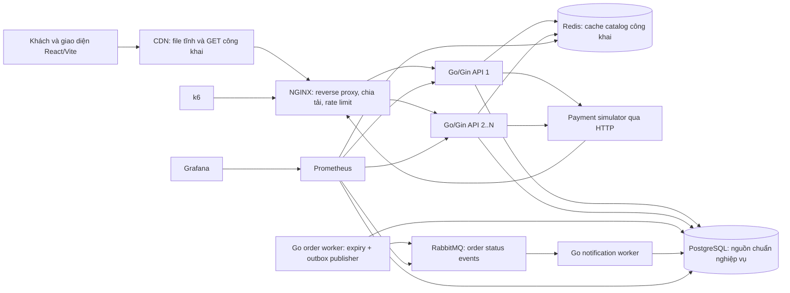

# Kiến trúc mục tiêu — SaleScale

## Sơ đồ dịch vụ và dữ liệu

## Vai trò gắn với nghiệp vụ

- Go/Gin xử lý đăng nhập, catalog, giỏ, checkout, thanh toán thử nghiệm, tra cứu đơn và notification inbox.
- PostgreSQL là nguồn dữ liệu có thẩm quyền cho session, giá đã đặt, tồn, quota, đơn, idempotency, sự kiện outbox và notification inbox.
- Redis chỉ giữ bản sao tạm của catalog công khai. Checkout vẫn đọc và kiểm tra giá/tồn từ PostgreSQL; giỏ, đơn và notification cá nhân không nằm trong public cache.
- NGINX chuyển request tới một hoặc nhiều API instance. Session và trạng thái nghiệp vụ ở PostgreSQL nên không cần sticky session để bảo đảm tính đúng.
- RabbitMQ chỉ chuyển order status event tới notification worker. Nó không quyết định giữ hàng, xác nhận thanh toán, hủy hoặc hết hạn.
- CDN phục vụ file tĩnh và GET catalog công khai có Cache-Control cho phép. Nếu lab không có CDN thật, NGINX proxy_cache chỉ dùng để thử nguyên tắc cache tại một máy.
- Payment simulator dùng HTTP để tạo kết quả thành công, thất bại, timeout, callback lặp hoặc đến muộn.
- Go order worker vừa trả reservation hết hạn vừa gửi outbox event; notification worker ghi notification vào PostgreSQL.

## Luồng notification và độ bền dữ liệu

1. Khi order đổi trạng thái, transaction PostgreSQL đồng thời ghi order và outbox event. Ở E0, cùng transaction ghi notification trực tiếp để tạo baseline.
2. Từ E1, order worker đọc event chưa gửi trong outbox và publish sang RabbitMQ bằng amqp091-go. Chỉ đánh dấu event đã gửi sau publisher confirm.
3. Notification worker nhận message với manual ACK, ghi notification bằng event ID duy nhất trong PostgreSQL, commit rồi mới ACK.
4. Nếu RabbitMQ dừng, outbox vẫn còn và checkout vẫn dùng được nếu PostgreSQL hoạt động; notification sẽ đến trễ rồi được gửi bù khi broker phục hồi.
5. Nếu publisher dừng sau khi broker nhận event nhưng trước khi DB đánh dấu đã gửi, worker có thể publish lại. Unique event ID giúp consumer xử lý lặp mà không tạo notification thứ hai.
6. Message lỗi được retry hữu hạn rồi chuyển dead-letter queue để người vận hành tra cứu; không retry vô hạn trong notification worker.

## Giới hạn kiến trúc

- RabbitMQ triển khai một node trong lab, chưa chứng minh HA hoặc chịu lỗi toàn cụm.
- PostgreSQL và RabbitMQ có thể nhận cùng lúc tải từ checkout và notification worker; giới hạn pool/prefetch cần được đo thay vì tăng tùy ý.
- Hộp thông báo là P1 và có thể cập nhật sau khi trạng thái đơn đã đổi. Trang đơn luôn đọc trạng thái chuẩn từ PostgreSQL.
- Không dùng RabbitMQ để trả kết quả đặt đơn bất đồng bộ, không tách nghiệp vụ thành microservice và không thêm dịch vụ gửi email/SMS/push.
