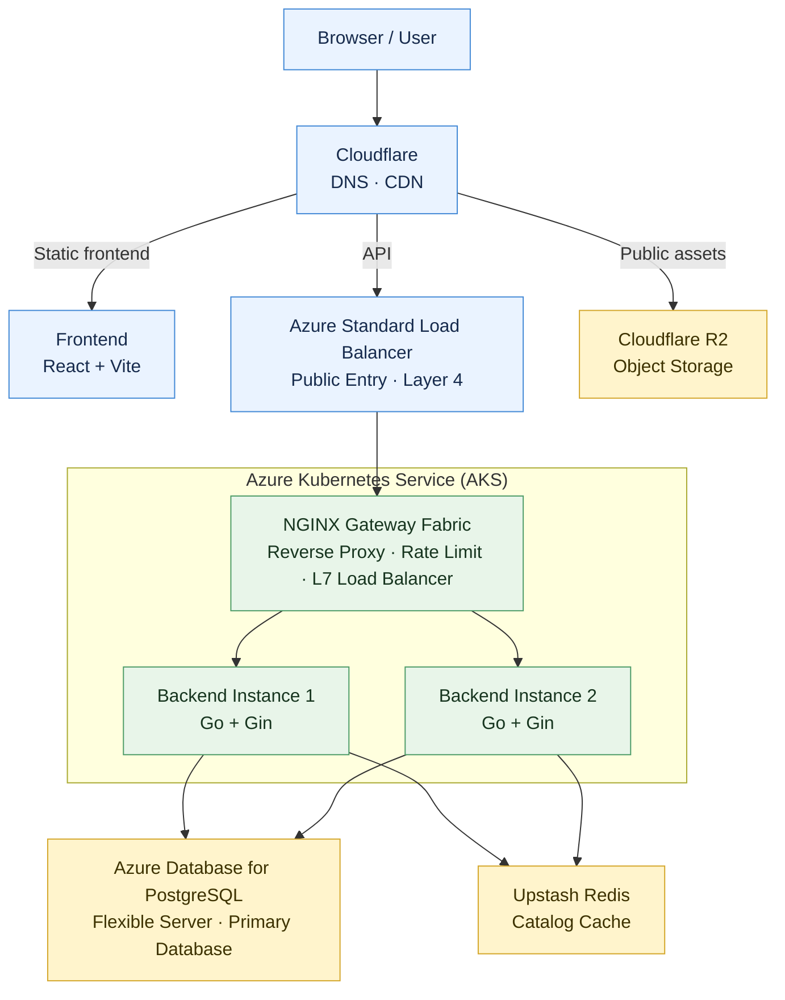
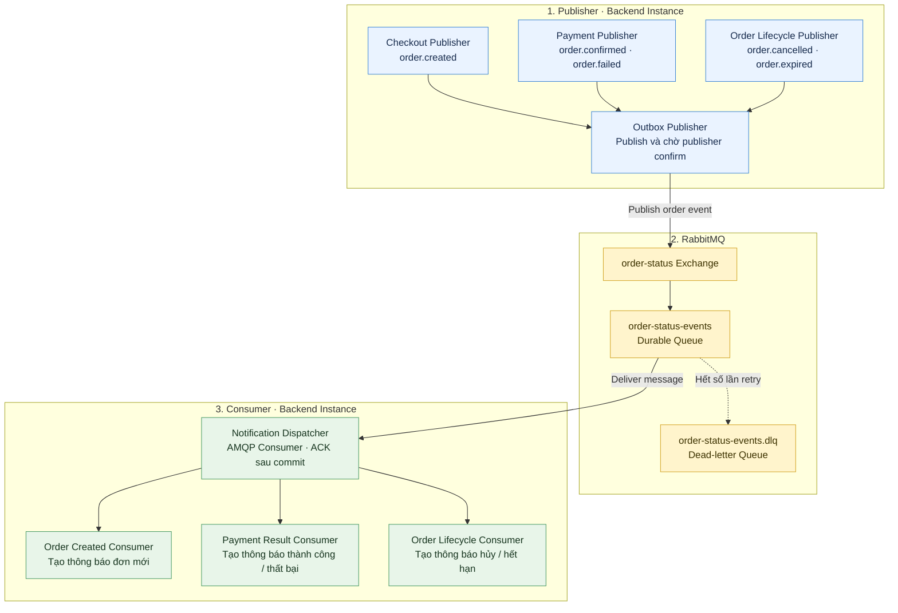

# Kiến trúc mục tiêu — SaleScale

## Sơ đồ công nghệ

## Các quyết định chính

- Azure Kubernetes Service (AKS) là môi trường cloud mục tiêu. Docker Compose vẫn là môi trường local và baseline để các phép đo E0–E4 có thể chạy lại với chi phí thấp.
- Azure Standard Load Balancer là cổng L4 đưa traffic vào AKS. NGINX Gateway Fabric bên trong cluster mới đảm nhiệm reverse proxy, rate limit và chia request L7 cho hai backend instance.
- Hai backend instance chạy cùng image Go/Gin và không giữ trạng thái nghiệp vụ riêng trong memory.
- PostgreSQL primary là nguồn dữ liệu có thẩm quyền cho session, giá, tồn, quota, đơn, idempotency, payment, outbox và notification inbox.
- Redis dùng cache-aside cho GET catalog công khai. API đọc Redis trước, tự fallback sang PostgreSQL khi cache miss rồi ghi lại cache; Redis không kết nối trực tiếp tới PostgreSQL và không quyết định checkout.
- Cloudflare R2 chỉ giữ ảnh sản phẩm và object tĩnh. PostgreSQL giữ object key/URL cùng metadata; R2 không đồng bộ dữ liệu nghiệp vụ với PostgreSQL.

## Vì sao bỏ read database và Kafka khỏi sơ đồ ban đầu

MVP chưa có số đo chứng minh PostgreSQL primary là nút thắt đọc. Catalog đã có Redis và CDN để giảm tải, trong khi checkout cần dữ liệu mới nhất về giá, tồn, quota và idempotency. Thêm read replica lúc này làm tăng chi phí vận hành và có nguy cơ đọc dữ liệu trễ.

Kafka cũng không phải cơ chế sao chép PostgreSQL trong kiến trúc này. Nếu sau benchmark thật sự cần read replica, dùng PostgreSQL native streaming replication/Azure read replica và chỉ chuyển các truy vấn chấp nhận eventual consistency như catalog hoặc báo cáo. Checkout, session, order detail sau ghi và payment vẫn đọc primary.

## Vai trò từng khối

| Khối | Vai trò trong SaleScale | Ràng buộc |
|---|---|---|
| React + Vite | Giao diện khách và quản trị | Build thành file tĩnh; không giữ trạng thái nghiệp vụ có thẩm quyền |
| Cloudflare CDN | Phân phối frontend, ảnh và GET công khai được phép cache | Không cache session, cart, order, payment hoặc notification |
| Azure Standard Load Balancer | Điểm vào public cho AKS ở tầng L4 | Chuyển TCP tới NGINX; không thay logic rate limit của ứng dụng |
| NGINX Gateway Fabric | TLS/routing, reverse proxy, load balancing và rate limit | Lab giữ một gateway replica để ngưỡng limit không tự nhân theo replica |
| Backend instance 1 và 2 | Hai pod Go/Gin cùng xử lý API | Stateless; cùng dùng PostgreSQL và Redis; không cần sticky session |
| Azure Database for PostgreSQL | Nguồn chuẩn nghiệp vụ và transaction | Mọi quyết định tiền/tồn/order dùng primary |
| Upstash Redis | Cache catalog công khai | TTL + invalidation; fallback PostgreSQL có giới hạn |
| Cloudflare R2 | Ảnh sản phẩm/object tĩnh | Không chứa session, order, inventory hoặc payment state |

## Thành phần chưa thể hiện trong sơ đồ tổng quan

RabbitMQ, order/outbox worker, notification worker, order events, payment simulator, Prometheus, Grafana và k6 vẫn thuộc phạm vi dự án. Chúng được tách khỏi sơ đồ này để sơ đồ chỉ tập trung vào các cụm hạ tầng và đường request chính; luồng chi tiết sẽ được vẽ riêng.

## Sơ đồ component — Publisher → RabbitMQ → Consumer

Ba Publisher nghiệp vụ tạo các loại order event tương ứng. `Outbox Publisher` là component duy nhất kết nối và gửi event lên RabbitMQ. `Notification Dispatcher` là AMQP consumer nhận message từ queue, sau đó chuyển đến một trong ba Consumer nghiệp vụ theo `event_type`.

Event chỉ mang `event_id`, `order_id`, `event_type` và `occurred_at`. PostgreSQL và API đọc notification không được lặp lại trong sơ đồ này để giữ đúng ba tầng; quy tắc outbox transaction, chống trùng theo `event_id` và ACK sau commit vẫn được giữ nguyên.

## Môi trường triển khai

| Môi trường | Cách chạy | Mục đích |
|---|---|---|
| Local/baseline | Docker Compose: NGINX, Go, PostgreSQL, Redis, RabbitMQ, Prometheus, Grafana | Phát triển, test lỗi dịch vụ và benchmark có thể lặp lại |
| Cloud target | AKS + Azure Standard Load Balancer; RabbitMQ một node nội bộ; Azure Database for PostgreSQL; Upstash Redis; Cloudflare CDN/R2 | Demo kiến trúc cloud với cùng container và biến môi trường; không đại diện cho HA |

AKS không tự động chứng minh hệ thống scale tốt. Báo cáo vẫn phải so 1/2/4 API pod với cùng tổng CPU/RAM, cùng seed, cùng workload và cùng ngân sách kết nối PostgreSQL.

## Giới hạn có chủ đích

- Chưa thêm autoscaling, service mesh, multi-region, database sharding, database HA hoặc broker HA.
- Chưa thêm PostgreSQL read replica; chỉ bổ sung khi metric cho thấy tải đọc trên primary là bottleneck và route đọc chịu được replication lag.
- NGINX rate limit trong MVP được đo với một gateway replica. Muốn scale gateway mà vẫn giữ một quota toàn hệ thống cần limiter dùng trạng thái chung hoặc giới hạn tại edge.
- R2 chỉ phục vụ media/object; upload trực tiếp bằng presigned URL chưa thuộc yêu cầu hiện tại.
- Cấu hình cloud không thay thế baseline Docker Compose và không được dùng để trộn lợi ích orchestration với lợi ích tăng phần cứng.

## Căn cứ kỹ thuật

- [Azure Kubernetes Service](https://learn.microsoft.com/en-us/azure/aks/what-is-aks)
- [Azure Standard Load Balancer trong AKS](https://learn.microsoft.com/en-us/azure/aks/load-balancer-standard)
- [Azure Database for PostgreSQL Flexible Server](https://learn.microsoft.com/en-us/azure/postgresql/flexible-server/overview)
- [NGINX Gateway Fabric](https://docs.nginx.com/nginx-gateway-fabric)
- [NGINX Gateway Fabric rate limit policy](https://docs.nginx.com/nginx-gateway-fabric/traffic-management/rate-limit/)
- [Kubernetes: ingress-nginx retirement](https://kubernetes.io/blog/2025/11/11/ingress-nginx-retirement/)
- [Redis cache-aside](https://redis.io/docs/latest/develop/use-cases/cache-aside/)
- [RabbitMQ acknowledgements and publisher confirms](https://www.rabbitmq.com/docs/confirms)
- [Cloudflare R2 S3-compatible API](https://developers.cloudflare.com/r2/get-started/s3/)
