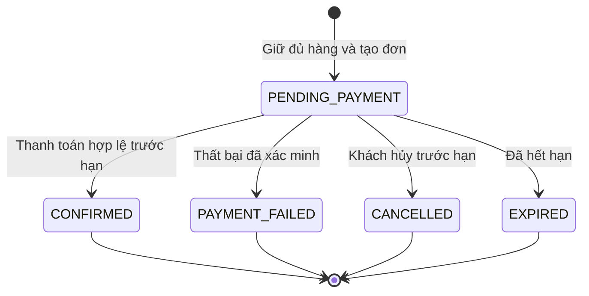

# PRD — SaleScale: Backend Flash Sale cho doanh nghiệp

## Thông tin tài liệu

| Thuộc tính | Nội dung |
|---|---|
| Phiên bản | 1.4 — Chuyển môi trường cloud mục tiêu sang Azure AKS |
| Ngày cập nhật | 11/10/2026 |
| Sản phẩm | SaleScale |
| Đề tài đồ án | Tối ưu hóa tầng API trong hệ thống Flash Sale phân tán sử dụng Go và Gin |
| Thời gian và nhân sự | 12 tuần, 2 người |
| Khách hàng mục tiêu | Một doanh nghiệp thuê backend để vận hành cửa hàng độc lập |
| Mô hình triển khai | Mỗi doanh nghiệp có bản triển khai, dữ liệu và cấu hình riêng |
| Trọng tâm | Đặt đơn đồng thời với giỏ nhiều sản phẩm; tốc độ xử lý và tính đúng đắn |
| Công nghệ người dùng đã chọn | Go, Gin |
| Công nghệ giao diện đã chọn | React, Vite |
| Công nghệ đề xuất cho thực nghiệm | PostgreSQL, Redis, NGINX, k6 |
| Công nghệ triển khai cloud | Azure Kubernetes Service (AKS); Docker Compose vẫn dùng cho local và baseline |
| Đầu ra | Backend, giao diện demo tối thiểu, tài liệu API, kiểm thử nghiệp vụ và báo cáo trước/sau tối ưu |

**Cách đọc trạng thái quyết định:**

- **Đã xác nhận:** lựa chọn được người dùng xác nhận trong trao đổi về ý tưởng.
- **Đề xuất MVP:** quy tắc bổ sung để tài liệu đủ cụ thể cho thiết kế và nghiệm thu; chưa phải xác nhận của chủ sản phẩm.
- **Cần chốt:** chi tiết còn mở ngoài các quyết định đã xác nhận; được tập hợp tại mục 17.3.

Các quyết định tại mục 17.2 là cơ sở triển khai và nghiệm thu. Khi có thay đổi, phải cập nhật quy tắc liên quan, tiêu chí nghiệm thu và kịch bản kiểm thử cùng nhau. Tài liệu này xác định sản phẩm và hành vi cần đạt; thiết kế bảng dữ liệu, cấu trúc mã nguồn và hợp đồng API chi tiết thuộc tài liệu triển khai sau đó.

## 1. Tóm tắt sản phẩm dành cho doanh nghiệp

### 1.1. Sản phẩm và mô hình cung cấp

SaleScale là backend bán hàng hỗ trợ flash sale, được cung cấp cho doanh nghiệp thuê để vận hành cửa hàng của chính họ. Một bản triển khai phục vụ một doanh nghiệp, nhiều danh mục sản phẩm và nhiều khách mua hàng của doanh nghiệp đó.

Doanh nghiệp quản lý sản phẩm, biến thể, tồn kho, chương trình flash sale và đơn hàng. Khách hàng xem sản phẩm, thêm nhiều mặt hàng vào giỏ, đặt một đơn và thanh toán chung. Thanh toán trong đồ án ở mức thử nghiệm/mô phỏng, không sử dụng tiền thật.

Mô hình cho thuê là định hướng thị trường của sản phẩm. MVP không xây hệ thống thu phí thuê backend, hợp đồng điện tử hay cổng quản lý nhiều doanh nghiệp. Việc bàn giao và triển khai được thực hiện riêng cho từng doanh nghiệp.

### 1.2. Vấn đề cần giải quyết

Khi flash sale bắt đầu, nhiều khách hàng cùng gửi yêu cầu đặt đơn vào một nhóm sản phẩm có số lượng giới hạn. Giỏ hàng có nhiều mặt hàng khiến hệ thống phải kiểm tra và giữ đồng thời nhiều nguồn tồn kho. Retry từ khách hàng, phản hồi thanh toán đến muộn và tác vụ hết hạn có thể cùng tác động đến một đơn.

Backend cần duy trì thời gian phản hồi có thể đo được, đồng thời không bán vượt số lượng, không tạo đơn trùng và không để lại hàng bị giữ sau một lần đặt đơn thất bại. Chỉ tăng số API instance chưa đủ để kết luận hệ thống xử lý được bài toán này.

### 1.3. Giá trị cung cấp

| Đối tượng | Giá trị cần đạt | Bằng chứng trong MVP |
|---|---|---|
| Doanh nghiệp | Vận hành cửa hàng riêng, kiểm soát hàng hóa và các đợt bán giới hạn | Bản triển khai độc lập; luồng quản trị và mua hàng hoàn chỉnh |
| Khách mua hàng | Biết rõ hàng mua, giá phải trả và trạng thái đơn; không bị âm thầm bỏ mặt hàng | Giỏ nhiều sản phẩm; xác nhận lại khi giá thay đổi hoặc thiếu hàng |
| Người vận hành | Theo dõi tải, lỗi và đơn cần đối soát | Chỉ số hệ thống, nhật ký liên kết theo request/đơn và danh sách bất thường |
| Nhóm đồ án | Chứng minh hiệu quả tối ưu API bằng thực nghiệm có thể lặp lại | Bộ kịch bản tải, dữ liệu đầu vào, kết quả gốc và phân tích trước/sau |

Điểm khác biệt của đồ án là xử lý đặt đơn đồng thời với giỏ nhiều mặt hàng và đánh giá cả tốc độ lẫn tính đúng đắn. Không tuyên bố sản phẩm mới trên thị trường hoặc năng lực chịu tải cụ thể khi chưa có bằng chứng.

## 2. Mục tiêu, kết quả thành công và nguyên tắc ưu tiên

### 2.1. Mục tiêu sản phẩm

| Mã | Mục tiêu | Điều kiện thành công |
|---|---|---|
| GOAL-01 | Hoàn thành nghiệp vụ bán hàng đã thống nhất | Quản trị tạo hàng và flash sale; khách tạo giỏ nhiều mặt hàng, đặt đơn, thanh toán thử nghiệm và xem kết quả |
| GOAL-02 | Bảo đảm tính đúng đắn khi đặt đơn đồng thời | Không phát hiện vi phạm các bất biến INV-01 đến INV-12 trong bộ kiểm thử đã công bố |
| GOAL-03 | Đánh giá tối ưu tầng API | Có baseline đúng nghiệp vụ; đo từng thay đổi và xác định điểm nghẽn dựa trên dữ liệu |
| GOAL-04 | Kiểm chứng mở rộng số API instance | So sánh ít nhất cấu hình 1 và 2 instance với điều kiện tài nguyên được ghi rõ |
| GOAL-05 | Cung cấp bản triển khai cho một doanh nghiệp | Cấu hình cửa hàng và dữ liệu độc lập; có hướng dẫn dựng môi trường và chạy kiểm thử |
| GOAL-06 | Hoàn thành trong 12 tuần, 2 người | Có các mốc bàn giao tại mục 16; không mở rộng sang nghiệp vụ ngoài mục 4 |
| GOAL-07 | Thử xử lý tác vụ thông báo ngoài luồng đặt hàng | Khách tra cứu được thông báo trạng thái đơn; RabbitMQ tạm dừng không làm mất đơn hoặc chặn checkout |

### 2.2. Nguyên tắc ưu tiên

1. Tính đúng đắn của đơn, tồn kho và thanh toán là điều kiện bắt buộc trước khi đánh giá hiệu năng.
2. Ưu tiên tối ưu API đặt đơn; cache đọc sản phẩm là phần hỗ trợ.
3. Một lần đặt đơn phải giữ đủ tất cả mặt hàng hoặc không giữ mặt hàng nào.
4. Backend quyết định giá, tồn kho, thời hạn và trạng thái; dữ liệu từ giao diện chỉ thể hiện lựa chọn của khách.
5. Tối ưu theo chu trình đo baseline → xác định điểm nghẽn → thay đổi → đo lại → kiểm chứng nghiệp vụ.
6. Kết quả từ chối hợp lệ do hết hàng phải được phân biệt với timeout, lỗi hệ thống và từ chối do giới hạn tải.
7. Không đổi quy tắc nghiệp vụ giữa các phiên bản chỉ để làm chỉ số tốc độ đẹp hơn.

### 2.3. Định nghĩa thành công thương mại trong phạm vi đồ án

MVP chứng minh doanh nghiệp có thể vận hành một cửa hàng riêng và thực hiện đợt flash sale với năng lực đã đo. Doanh thu, tỷ lệ chuyển đổi, giá thuê, lợi nhuận và SLA thương mại chưa có dữ liệu thực tế nên không dùng làm chỉ tiêu nghiệm thu đồ án.

## 3. Người dùng, bên liên quan và quyền hạn

### 3.1. Nhóm người dùng

| Nhóm | Nhu cầu chính | Quyền trong MVP |
|---|---|---|
| Khách chưa đăng nhập | Khám phá hàng hóa và thông tin flash sale | Xem sản phẩm, danh mục, biến thể và chương trình công khai |
| Khách đã đăng nhập | Mua nhiều sản phẩm và theo dõi đơn | Quản lý giỏ của mình; đặt đơn; mở thanh toán; xem và hủy đơn của mình khi còn chờ thanh toán |
| Quản trị doanh nghiệp | Chuẩn bị hàng và theo dõi bán hàng | Quản lý danh mục, sản phẩm, biến thể, tồn kho, chương trình; xem đơn và bất thường thanh toán |
| Người vận hành bản triển khai | Cấu hình và quan sát hệ thống | Quản lý cấu hình môi trường, chạy benchmark và xem chỉ số kỹ thuật qua quyền vận hành riêng |

Không xây vai trò người bán độc lập, cộng tác viên, nhân viên kho hoặc phân quyền nhiều cấp trong MVP. Người vận hành không có quyền sửa tùy ý trạng thái thanh toán hoặc tồn kho để làm cho báo cáo khớp.

### 3.2. Các quy tắc phân quyền

- Khách chỉ được truy cập giỏ, đơn, phiên thanh toán và thông tin người nhận thuộc tài khoản của mình.
- Khách không được tự chọn vai trò quản trị hoặc tự đặt trạng thái thanh toán thành công.
- API quản trị yêu cầu quyền quản trị; thay đổi tồn kho và cấu hình flash sale phải lưu người thực hiện và thời điểm.
- Chức năng điều khiển thanh toán mô phỏng dành cho môi trường thử nghiệm, quản trị thử nghiệm hoặc công cụ test có xác thực; không phải quyền thông thường của khách.
- Các bản triển khai doanh nghiệp khác nhau không dùng chung dữ liệu tài khoản, tồn kho, đơn hoặc cache riêng tư.

## 4. Phạm vi sản phẩm

### 4.1. Phạm vi đã xác nhận

| Mã | Quyết định | Trạng thái |
|---|---|---|
| SCOPE-01 | Backend cho doanh nghiệp thuê; triển khai riêng cho từng doanh nghiệp | Đã xác nhận |
| SCOPE-02 | Một cửa hàng có nhiều danh mục hàng vật lý, cùng quy trình mua | Đã xác nhận |
| SCOPE-03 | Giỏ có nhiều sản phẩm, thanh toán chung | Đã xác nhận |
| SCOPE-04 | Thiếu bất kỳ mặt hàng nào khi đặt đơn thì từ chối toàn bộ, chỉ rõ hàng thiếu | Đã xác nhận |
| SCOPE-05 | Thanh toán ở mức thử nghiệm/mô phỏng | Đã xác nhận |
| SCOPE-06 | Đặt đơn đồng thời là trọng tâm; cache đọc sản phẩm hỗ trợ | Đã xác nhận |
| SCOPE-07 | Go và Gin; 12 tuần, 2 người | Đã xác nhận |
| SCOPE-08 | Hộp thông báo trạng thái đơn dùng RabbitMQ; checkout vẫn đồng bộ với PostgreSQL | Đã xác nhận theo yêu cầu mở rộng đồ án |
| SCOPE-09 | Bản triển khai cloud mục tiêu dùng Azure Kubernetes Service (AKS); lab và baseline vẫn dùng Docker Compose | Đã xác nhận |

### 4.2. Chức năng bắt buộc của bản MVP

1. Đăng ký, đăng nhập, đăng xuất và phân quyền cơ bản.
2. Cấu hình nhận diện cửa hàng và thông tin liên hệ tối thiểu.
3. Danh mục, sản phẩm vật lý, biến thể và tồn kho theo SKU.
4. Hiển thị, lọc, tìm kiếm đơn giản và phân trang sản phẩm.
5. Quản trị chương trình flash sale và các SKU tham gia.
6. Giỏ nhiều mặt hàng, xem trước giá và kiểm tra điều kiện đặt đơn.
7. Tạo đơn nguyên tử cho toàn bộ giỏ, giữ hàng có thời hạn và chống tạo đơn trùng.
8. Thanh toán mô phỏng có phản hồi bất đồng bộ và bộ tình huống thử nghiệm.
9. Xác nhận, hết hạn, thất bại hoặc hủy đơn đang chờ; giải phóng hàng đúng một lần.
10. Lịch sử đơn của khách, tra cứu đơn của quản trị và theo dõi bất thường thanh toán.
11. Giao diện demo tối thiểu cho khách và quản trị.
12. Tối ưu transaction/truy vấn/pool, chạy nhiều instance, cache đọc, kiểm soát tải và quan sát hệ thống.
13. Hộp thông báo trạng thái đơn, được tạo bất đồng bộ qua RabbitMQ và có thể xem trong ứng dụng.
14. Bộ kiểm thử nghiệp vụ đồng thời và báo cáo hiệu năng có dữ liệu gốc.

### 4.3. Ngoài phạm vi

- Nền tảng chung cho nhiều doanh nghiệp, marketplace, nhiều người bán và chia tiền cho người bán.
- Thu phí thuê backend, quản lý hợp đồng hoặc tự động tạo hàng loạt bản triển khai.
- Voucher, sản phẩm số, khóa học, cấp mã hoặc cấp quyền truy cập.
- Thanh toán tiền thật; hoàn tiền thật; tích hợp nhiều cổng thanh toán.
- Giỏ chia thành nhiều đơn thanh toán độc lập hoặc tự động mua một phần giỏ.
- Mã giảm giá, điểm thưởng, thành viên, nhiều loại ưu đãi cộng dồn.
- Giao hàng thật, tích hợp vận chuyển, quản lý nhiều kho, ERP/POS và đồng bộ tồn kho bên ngoài.
- Theo dõi giao vận, đổi trả sau mua, kế toán, hóa đơn điện tử hoặc tính thuế phức tạp.
- Chỉnh sửa/hủy đơn đã thanh toán để trả hàng tự động trong MVP.
- Đánh giá sản phẩm, chat, gợi ý cá nhân hóa, ứng dụng di động hoặc giao diện thương mại hoàn chỉnh.
- Tự động scale theo cloud, chia nhiều microservice, sharding hoặc nghiên cứu HA cho database; AKS chỉ là nền tảng orchestration của bản cloud mục tiêu.
- Đưa toàn bộ checkout vào hàng đợi rồi trả kết quả đặt đơn về sau.
- Email, SMS, push notification hoặc nền tảng sự kiện dùng chung cho nhiều sản phẩm; MVP chỉ có hộp thông báo trạng thái đơn trong ứng dụng.
- Chứng nhận sẵn sàng production hoặc cam kết SLA thương mại dựa trên benchmark đồ án.

## 5. Thuật ngữ và thông tin nghiệp vụ

### 5.1. Thuật ngữ

| Thuật ngữ | Ý nghĩa |
|---|---|
| Sản phẩm | Mặt hàng gốc, ví dụ áo thun A |
| Biến thể/SKU | Đơn vị bán và quản lý tồn kho, ví dụ áo A màu đen size M |
| Giỏ hàng | Danh sách SKU và số lượng khách dự định mua; không tạo quyền sở hữu hàng |
| Xem trước đơn | Giá và điều kiện mua tại thời điểm xem; chưa giữ hàng và chưa tạo đơn |
| Đặt đơn/checkout | Kiểm tra lại điều kiện, giữ hàng và tạo đơn chờ thanh toán |
| Reservation | Bản ghi quyền giữ một số lượng SKU cho một đơn trong thời hạn xác định |
| Hạn mức flash sale/quota | Số lượng tối đa được bán với giá flash sale cho một SKU trong một chương trình |
| Idempotency | Gửi lại cùng một yêu cầu không tạo thêm tác động nghiệp vụ |
| Callback/webhook | Thông báo kết quả thanh toán từ bộ mô phỏng hoặc môi trường thử nghiệm tới backend |
| Đối soát | Kiểm tra một kết quả thanh toán không thể tự động áp dụng vào đơn |
| API instance | Một tiến trình backend phục vụ request; nhiều instance dùng cùng dữ liệu nghiệp vụ |
| Baseline | Phiên bản đúng nghiệp vụ dùng làm mốc so sánh trước tối ưu |
| Outbox | Bản ghi sự kiện được lưu trong cùng giao dịch với thay đổi đơn, để gửi đi sau mà không mất sự kiện khi broker tạm lỗi |
| Message queue | Hàng đợi nhận sự kiện và giao cho worker xử lý sau request; RabbitMQ đảm nhiệm phần này trong đồ án |
| Hộp thông báo đơn | Danh sách thông báo riêng của khách về việc giữ hàng, thanh toán, hủy hoặc hết hạn đơn |
| p95/p99 | Độ trễ mà 95%/99% mẫu đo không vượt quá |

### 5.2. Các nhóm thông tin cần quản lý

| Đối tượng | Thông tin tối thiểu | Yêu cầu nghiệp vụ |
|---|---|---|
| Cửa hàng | Tên, mô tả ngắn, logo dạng URL, thông tin liên hệ, múi giờ hiển thị | Một cấu hình cho một bản triển khai |
| Tài khoản | Định danh, email đăng nhập, thông tin tên, vai trò, trạng thái | Không lưu hoặc trả mật khẩu dạng rõ |
| Danh mục | Tên, mã, mô tả ngắn, trạng thái hiển thị | Một cấp danh mục trong MVP |
| Sản phẩm | Tên, mô tả, danh mục, ảnh dạng URL, trạng thái | Chỉ sản phẩm hoạt động được đặt mới |
| SKU | Mã duy nhất, thuộc tính biến thể, giá thường, số lượng, trạng thái | Sản phẩm không có lựa chọn biến thể vẫn có một SKU |
| Flash sale | Tên, bắt đầu/kết thúc, trạng thái, danh sách SKU | Giá và hạn mức xác định riêng cho mỗi SKU |
| Mặt hàng flash sale | SKU, giá ưu đãi, quota, giới hạn mua/tài khoản | Có số đã giữ và đã bán để kiểm chứng hạn mức |
| Giỏ hàng | Chủ sở hữu, các dòng SKU/số lượng, phiên bản thay đổi | Một dòng cho một SKU; thay đổi giỏ không thay đổi đơn đã tạo |
| Đơn hàng | Mã đơn, chủ sở hữu, trạng thái, tổng tiền, hạn thanh toán, thông tin người nhận | Giá và dữ liệu mặt hàng được chụp tại thời điểm đặt |
| Dòng đơn | SKU, tên/thuộc tính chụp lại, số lượng, đơn giá, nguồn giá | Không phụ thuộc giá hiện tại sau khi đơn đã tạo |
| Giữ hàng | Đơn, SKU, số lượng, hạn giữ, trạng thái, chương trình nếu có | Truy nguyên được hàng giữ, chuyển thành bán hoặc giải phóng |
| Thanh toán | Mã phiên, đơn, số tiền, tiền tệ, kết quả đã xác minh | Một phiên cho một đơn; retry trả phiên cũ |
| Sự kiện thanh toán | Mã sự kiện, mã giao dịch, thời điểm tiếp nhận, kết quả xử lý | Nhận lại sự kiện không làm lặp tác động |
| Bất thường | Đơn/phiên, loại vấn đề, bằng chứng, trạng thái rà soát | Không đồng nghĩa với việc đơn đã thanh toán |
| Sự kiện outbox | Mã sự kiện, đơn, loại thay đổi trạng thái, thời điểm, trạng thái đã gửi | Được lưu cùng giao dịch đổi trạng thái đơn; publisher có thể gửi lại sau khi RabbitMQ phục hồi |
| Thông báo khách | Chủ sở hữu, đơn, mã sự kiện, nội dung ngắn, trạng thái đã đọc, thời điểm | Khách chỉ xem được thông báo của mình; một sự kiện chỉ tạo tối đa một thông báo |
| Nhật ký nghiệp vụ | Tác nhân, thao tác, đối tượng, trước/sau, thời điểm | Phục vụ kiểm tra điều chỉnh tồn và tranh chấp trạng thái |

Đây là mô hình thông tin nghiệp vụ, không quy định mỗi đối tượng phải là một bảng database riêng.

## 6. Quy tắc nghiệp vụ

### 6.1. Cửa hàng, sản phẩm và tiền tệ

- **BR-01 — Độc lập triển khai:** một bản triển khai chỉ quản lý cửa hàng của một doanh nghiệp. Không có luồng khách chọn người bán hoặc quản trị chọn tenant.
- **BR-02 — Đơn vị tồn kho:** tồn kho quản lý theo SKU; các màu/kích cỡ khác nhau không dùng chung số lượng nếu là SKU khác nhau.
- **BR-03 — Hiệu lực hàng hóa:** danh mục không hiển thị hoặc sản phẩm/SKU ngừng bán không được đưa vào đơn mới. Đơn đã tạo vẫn giữ bản chụp để tra cứu.
- **BR-04 — Lưu lịch sử:** hàng hóa, SKU hoặc chương trình đã được tham chiếu bởi đơn được ngừng hoạt động thay vì xóa mất lịch sử.
- **BR-05 — Tiền:** MVP dùng VND, số tiền nguyên, giá lớn hơn 0 và số lượng nguyên dương. Không dùng phép tính số thực có sai số để tính tổng tiền.
- **BR-06 — Tổng tiền:** tổng tiền bằng tổng số lượng × đơn giá của các dòng. MVP không thu phí vận chuyển, không áp thêm mã giảm giá và không tách thuế.

### 6.2. Giỏ hàng và giá

- **BR-07 — Giỏ không giữ hàng:** thêm/sửa giỏ không giảm tồn khả dụng hoặc quota. Thông tin còn hàng trên màn hình không bảo đảm đặt đơn sẽ thành công.
- **BR-08 — Giỏ nhiều mặt hàng:** khách chọn toàn bộ hoặc một tập dòng để đặt; đơn được tạo từ tập đã xác nhận, không tự bổ sung các dòng khác.
- **BR-09 — Gộp SKU và giới hạn giỏ:** nhiều lần thêm cùng SKU gộp vào một dòng; một giỏ có tối đa 20 SKU. Giới hạn số lượng được kiểm tra trên tổng số lượng SKU đó theo cấu hình SKU/chương trình. Không cho dùng nhiều dòng trùng SKU để né giới hạn; mọi giới hạn áp dụng ở backend, không chỉ giao diện.
- **BR-10 — Giá có thẩm quyền:** backend tính giá từ dữ liệu hiện hành. Client không được tự đặt giá flash sale, tổng tiền hoặc nguồn khuyến mãi.
- **BR-11 — Xác nhận thay đổi giá:** nếu giá/nguồn giá hoặc tổng tiền khác bản khách vừa xác nhận, từ chối đặt đơn với `PRICE_CHANGED`, trả giá mới và yêu cầu khách xác nhận lại. Không âm thầm tính giá thường khi giá flash sale đã hết hiệu lực.
- **BR-12 — Giá đã đặt:** đơn giữ nguyên giá được chốt trong thời hạn thanh toán, kể cả chương trình kết thúc trong lúc khách đang thanh toán. Đơn hết hạn không được hồi sinh để tiếp tục hưởng giá cũ.
- **BR-13 — Giỏ sau đặt đơn:** giữ nguyên giỏ sau khi tạo đơn chờ thanh toán. Khi thanh toán thành công, chỉ loại các dòng đã mua nếu dòng đó chưa thay đổi so với lần đặt; không xóa sản phẩm mới thêm hoặc số lượng khách vừa sửa. Nếu không bảo đảm cập nhật an toàn, giữ giỏ và thông báo khách rà soát thay vì xóa nhầm.

### 6.3. Flash sale

- **BR-14 — Khoảng thời gian:** nhận đơn mới theo giờ có thẩm quyền của backend/database, trong khoảng `starts_at <= thời điểm kiểm tra < ends_at`. Giao diện chỉ hiển thị đếm ngược.
- **BR-15 — Trùng chương trình:** đề xuất một SKU không tham gia hai chương trình có khoảng nhận đơn chồng nhau. Giỏ được chứa hàng thường và hàng flash sale; từng dòng phải chỉ rõ nguồn giá đã xác nhận.
- **BR-16 — Điều kiện cấu hình:** thời điểm kết thúc sau bắt đầu; quota và giới hạn mua là số nguyên dương; giá flash sale nhỏ hơn giá thường tại lúc thiết lập. Một SKU chỉ có một cấu hình trong cùng chương trình; không tạo hai dòng ưu đãi trùng SKU.
- **BR-17 — Quota không thay thế tồn:** đơn flash sale phải thỏa cả tồn vật lý khả dụng và quota khả dụng. Quota là trần bán ưu đãi, không phải lượng hàng đã tách riêng khỏi kho vật lý.
- **BR-18 — Quota dùng chung:** số đã giữ và đã bán trong một chương trình không được vượt quota của SKU. Hàng đã bán không tự trở lại quota sau khi kết thúc chương trình.
- **BR-19 — Giới hạn mua:** với mỗi tài khoản, chương trình và SKU, tổng số lượng đang giữ cộng số đã mua không vượt giới hạn. Nhiều request với các khóa idempotency khác nhau vẫn phải tuân thủ giới hạn.
- **BR-20 — Hết quota:** nếu một dòng khách xác nhận theo giá flash sale không còn quota, từ chối toàn bộ lần đặt đơn. Không chia dòng thành một phần giá ưu đãi và một phần giá thường.
- **BR-21 — Khóa cấu hình:** sau khi chương trình được lên lịch, không sửa trực tiếp giá/quota/giới hạn của các mặt hàng. Trước khi chạy có thể hủy lịch rồi sửa; khi đang chạy chỉ cho dừng nhận đơn mới theo đề xuất MVP.
- **BR-22 — Kết thúc/dừng:** không nhận đơn flash sale mới khi đã kết thúc hoặc dừng. Đơn đã giữ hàng tiếp tục được thanh toán tới hạn riêng; không giải phóng toàn bộ reservation chỉ vì chương trình dừng.

### 6.4. Đặt đơn và giữ hàng

- **BR-23 — Nguyên tử cả giỏ:** chỉ tạo đơn có đủ tất cả reservation khi mọi dòng hợp lệ. Bất kỳ dòng nào không hợp lệ thì không tạo đơn chờ thanh toán và không lưu tác động giữ hàng của các dòng còn lại.
- **BR-24 — Báo rõ lỗi:** kết quả bị từ chối chỉ rõ SKU, số lượng yêu cầu và nguyên nhân có thể xác định. Tồn khả dụng trả về phản ánh thời điểm kiểm tra, không phải cam kết giữ hàng cho lần sau. Backend thu thập lỗi của các dòng có thể kiểm tra an toàn; không che lỗi hệ thống dưới dạng hết hàng. Nếu một dòng có nhiều lỗi, ưu tiên báo dữ liệu/hàng hóa không hợp lệ, chương trình/giá không còn đúng, giới hạn mua, rồi số lượng không đủ; có thể kèm các nguyên nhân bổ sung đã xác định.
- **BR-25 — Thời hạn giữ:** giữ hàng 5 phút từ lúc đơn được tạo. Hạn cụ thể được chụp vào đơn; thay đổi cấu hình không sửa hạn của đơn đang tồn tại.
- **BR-26 — Không kéo dài tự động:** retry, mở lại trang, mở lại phiên thanh toán hoặc gửi callback lặp không gia hạn giữ hàng.
- **BR-27 — Quyền giữ:** đơn chờ thanh toán có đủ reservation cho từng dòng; đơn đã xác nhận đã chuyển hết reservation thành lượng bán; đơn hủy/thất bại/hết hạn đã giải phóng hết reservation.
- **BR-28 — Hết hạn có thẩm quyền:** điều kiện thời hạn được kiểm tra lại trong thao tác chuyển trạng thái. Tác vụ nền chạy chậm không làm đơn hết hạn tiếp tục đủ điều kiện thanh toán.
- **BR-29 — Điều chỉnh kho:** quản trị không được giảm lượng tồn hiện còn xuống dưới lượng đang giữ. Không sửa tay lượng đã giữ, đã bán hoặc giá của đơn để vượt kiểm tra nghiệp vụ.
- **BR-30 — Đếm đúng:** gọi tác vụ giải phóng nhiều lần chỉ hoàn lại quyền giữ một lần; không làm lượng khả dụng vượt số hàng thực có.

### 6.5. Idempotency và kết quả không rõ do mất kết nối

- **BR-31 — Khóa đặt đơn:** client gửi khóa idempotency cho mỗi ý định đặt đơn, gắn với tài khoản và loại thao tác. Khóa không dùng để bỏ qua kiểm tra quyền sở hữu.
- **BR-32 — Gửi lại cùng nội dung:** request cùng tài khoản, khóa và nội dung chuẩn hóa chỉ tạo tối đa một đơn; lần gửi lại trả về định danh/kết quả đã ghi nhận, không giữ thêm hàng hoặc gia hạn đơn. Trạng thái hiện tại được truy vấn riêng nếu đơn đã chuyển trạng thái.
- **BR-33 — Nội dung khác:** cùng khóa nhưng nội dung khác trả `IDEMPOTENCY_CONFLICT`. Nội dung ảnh hưởng gồm SKU, số lượng, giá đã xác nhận, chương trình, tổng tiền/tiền tệ và thông tin người nhận.
- **BR-34 — Mất phản hồi:** nếu client timeout sau khi backend đã commit, client gửi lại cùng khóa hoặc tra cứu kết quả; không mặc định đơn thất bại và không tự tạo khóa mới ngay.
- **BR-35 — Request đồng thời cùng khóa:** phải được phối hợp trên dữ liệu dùng chung giữa các API instance. Có thể trả kết quả cũ hoặc `REQUEST_IN_PROGRESS` với cách retry rõ ràng; không tạo đơn thứ hai.
- **BR-36 — Sau khi sửa giỏ:** đây là ý định đặt đơn mới và dùng khóa mới. Kết quả từ chối nghiệp vụ đã lưu với khóa cũ không được đổi thành đơn mới khi gửi lại cùng khóa. Lỗi hạ tầng trước commit không được ghi thành kết quả nghiệp vụ cuối cùng.
- **BR-37 — Lưu khóa:** đề xuất giữ bằng chứng ánh xạ khóa → đơn suốt vòng đời dữ liệu đơn trong MVP. Không xóa khóa thành công trong khi khách vẫn có thể retry đơn đó.

### 6.6. Thanh toán và sự kiện đến muộn

- **BR-38 — Môi trường:** không dùng tiền thật hoặc cổng sandbox; chỉ dùng bộ mô phỏng bắt buộc.
- **BR-39 — Một phiên:** mỗi đơn có một phiên thanh toán. Gọi mở phiên lại trả phiên cũ; lỗi khởi tạo không rõ kết quả phải được tra cứu/retry cùng định danh, không tạo phiên độc lập tùy tiện.
- **BR-40 — Xác minh:** chỉ tin kết quả từ nguồn thử nghiệm được xác thực. Phải kiểm tra mã đơn, mã phiên/giao dịch, số tiền, tiền tệ và định danh sự kiện; trang redirect của client không đủ để xác nhận đã trả tiền.
- **BR-41 — Thành công đúng hạn:** chỉ xác nhận đơn còn `PENDING_PAYMENT`, còn đủ quyền giữ và chưa hết hạn tại thời điểm đánh giá có thẩm quyền trong thao tác chuyển trạng thái. Chuyển trạng thái đơn, reservation, tồn và quota phải nhất quán.
- **BR-42 — Cạnh tranh với hết hạn/hủy:** kết quả quyết định bằng trạng thái và thời hạn được kiểm tra trong cùng thao tác cập nhật được phối hợp. Tại đúng thời điểm hết hạn, đơn không còn đủ điều kiện xác nhận; thời gian do client hoặc bộ mô phỏng tự khai không được dùng để hồi sinh đơn.
- **BR-43 — Thành công đến muộn:** nếu đơn đã hủy/thất bại/hết hạn hoặc lúc xử lý đã hết hạn, lưu sự kiện cần đối soát; không tự xác nhận đơn, trừ tồn hay giữ lại hàng đã được trả. Không hoàn tiền thật trong MVP.
- **BR-44 — Thất bại chắc chắn:** kết quả thất bại đã xác minh đóng đơn đang chờ và giải phóng toàn bộ hàng. Khách muốn mua lại tạo đơn mới; không tự mở lại đơn cũ.
- **BR-45 — Kết quả chưa rõ:** timeout, mất callback hoặc lỗi kết nối không đồng nghĩa thanh toán thất bại. Đơn tiếp tục chờ tới hạn; có thể tra cứu phiên bằng chức năng thử nghiệm. Không giải phóng hàng chỉ vì một lần gọi bị timeout.
- **BR-46 — Sự kiện lặp:** nhận lại cùng sự kiện hoặc nhiều sự kiện cùng giao dịch không xác nhận/trừ tồn/giải phóng thêm lần nữa. Cần kiểm tra cả mã sự kiện lẫn trạng thái nghiệp vụ.
- **BR-47 — Sự kiện trái thứ tự:** thất bại đến sau thành công không đổi đơn đã xác nhận thành thất bại; thành công đến sau trạng thái kết thúc không tự khôi phục đơn. Kết quả mâu thuẫn được lưu để rà soát.
- **BR-48 — Sai số tiền/phiên:** không xác nhận đơn và không âm thầm điều chỉnh tổng tiền. Lưu bất thường, trả kết quả phù hợp với nguồn gửi và để đơn tuân thủ thời hạn hiện có.
- **BR-49 — Ghi nhận bền vững:** chỉ trả xác nhận đã nhận sự kiện khi sự kiện/kết quả xử lý đã được lưu bền vững. Nếu lưu thất bại, trả lỗi có thể retry; nếu xử lý bất đồng bộ phải có hàng đợi/bản ghi bền vững, không chỉ goroutine trong bộ nhớ.

### 6.7. Quy ước tồn kho và các bất biến bắt buộc

Với một SKU trong MVP, dùng quy ước nghiệp vụ:

```text
on_hand: số hàng hiện còn, bao gồm hàng đang được giữ, không bao gồm hàng đã bán
reserved: số hàng đang được giữ cho các đơn còn chờ
available = on_hand - reserved

Đặt đơn hợp lệ: reserved += số lượng; on_hand không đổi
Thanh toán hợp lệ: reserved -= số lượng; on_hand -= số lượng
Hủy/thất bại/hết hạn: reserved -= số lượng; on_hand không đổi

quota_available = quota_total - quota_reserved - quota_sold
Giữ hàng flash sale: quota_reserved += số lượng
Thanh toán hợp lệ: quota_reserved -= số lượng; quota_sold += số lượng
Giải phóng: quota_reserved -= số lượng; quota_sold không đổi
```

Không vừa giải phóng `reserved` vừa cộng lại `on_hand` khi đơn thất bại: theo quy ước này, hàng giữ chưa từng bị trừ khỏi `on_hand`. Quota khả dụng không bảo đảm tồn vật lý khả dụng vì hàng thường có thể dùng cùng kho.

| Mã | Bất biến phải kiểm chứng |
|---|---|
| INV-01 | `on_hand >= 0`, `reserved >= 0`, `available >= 0` và `reserved <= on_hand` cho mọi SKU |
| INV-02 | Tổng reservation đang giữ cho một SKU bằng `reserved` của SKU đó |
| INV-03 | Đơn chờ có reservation đúng số lượng cho tất cả dòng; không tồn tại đơn chờ giữ thiếu một phần |
| INV-04 | Lần đặt bị từ chối không để lại reservation hoặc thay đổi tồn/quota/giới hạn mua đã commit |
| INV-05 | Một tài khoản và khóa idempotency tạo tối đa một đơn |
| INV-06 | Mỗi reservation chỉ kết thúc một lần: chuyển thành bán hoặc giải phóng |
| INV-07 | Đơn xác nhận có kết quả thanh toán hợp lệ và các dòng đã được chuyển thành lượng bán đúng một lần |
| INV-08 | Đơn hủy/thất bại/hết hạn không còn reservation đang giữ; callback muộn không đảo ngược điều này |
| INV-09 | `quota_reserved >= 0`, `quota_sold >= 0` và `quota_reserved + quota_sold <= quota_total` |
| INV-10 | Số đang giữ + số đã mua của mỗi tài khoản theo chương trình/SKU không vượt giới hạn mua |
| INV-11 | Tổng tiền đơn bằng tổng các dòng đã chụp; phiên thanh toán dùng đúng tổng tiền và tiền tệ đó |
| INV-12 | Với mỗi SKU: tồn ban đầu + tổng điều chỉnh hợp lệ − tổng lượng của đơn xác nhận = `on_hand` hiện tại |

INV-03 và INV-08 áp dụng với trạng thái đã commit. Đơn quá hạn còn chờ do worker chưa chạy vẫn chiếm reservation trong sổ tồn, nhưng không được phép xác nhận thanh toán; sau thời hạn giải phóng đã thống nhất phải được chuyển sang hết hạn và trả quyền giữ.

### 6.8. Thông báo trạng thái đơn và hàng đợi

- **BR-46 — Sự kiện tạo thông báo:** khi đơn được tạo, xác nhận, thất bại, hủy hoặc hết hạn, backend tạo thông báo cho chủ đơn. Khách có thể xem danh sách và đánh dấu đã đọc; nội dung thông báo không thay thế trạng thái đơn trong PostgreSQL.
- **BR-47 — Lưu sự kiện cùng thay đổi đơn:** ở kiến trúc bất đồng bộ, PostgreSQL lưu sự kiện outbox trong cùng transaction với thay đổi trạng thái. Nhờ vậy đơn và yêu cầu gửi thông báo không thể chỉ lưu một nửa.
- **BR-48 — Checkout không chờ RabbitMQ:** worker gửi sự kiện outbox lên RabbitMQ sau khi transaction kết thúc. Nếu RabbitMQ ngừng hoạt động, đơn vẫn được tạo; sự kiện còn trong PostgreSQL và được gửi lại khi broker hoạt động.
- **BR-49 — Xử lý lặp an toàn:** publisher chỉ đánh dấu sự kiện đã gửi sau publisher confirm; consumer lưu thông báo theo event ID duy nhất và chỉ ACK sau khi PostgreSQL commit. Nếu sự kiện lỗi liên tục, retry có giới hạn rồi chuyển vào dead-letter queue để người vận hành kiểm tra.
- **BR-50 — Tách thông báo khỏi quyết định mua:** RabbitMQ chỉ chuyển thông báo trạng thái. Việc giữ hàng, xác nhận thanh toán, hủy và hết hạn vẫn được quyết định bằng trạng thái cùng transaction PostgreSQL.

## 7. Trạng thái và vòng đời

### 7.1. Chương trình flash sale

| Trạng thái | Ý nghĩa | Thao tác hợp lệ |
|---|---|---|
| `DRAFT` | Đang chuẩn bị, chưa nhận đơn | Sửa thông tin, SKU, giá, quota; lên lịch sau kiểm tra |
| `SCHEDULED` | Đã khóa cấu hình, chờ bắt đầu | Xem; hủy lịch trước giờ mở để quay về nháp |
| `RUNNING` | Trong khoảng thời gian bán và chưa dừng | Nhận đơn phù hợp; xem; dừng nhận đơn mới |
| `ENDED` | Đã tới giờ kết thúc | Xem lịch sử; không nhận đơn flash sale mới |
| `STOPPED` | Quản trị đã dừng chương trình đang chạy | Không nhận đơn mới; đơn giữ trước đó tiếp tục theo hạn riêng |

`RUNNING`/`ENDED` phải được xác định đúng theo thời gian ngay cả khi tác vụ cập nhật nhãn trạng thái bị chậm. MVP không khởi động lại chương trình đã dừng/kết thúc; muốn bán tiếp phải tạo chương trình mới không chồng thời gian của SKU.

Quản trị chuẩn bị chương trình mới khi chương trình cũ còn đơn chờ phải được cảnh báo rằng hàng cũ vẫn đang giữ. Backend kiểm tra tồn thực tế khi nhận đơn mới; không coi kết thúc chương trình cũ là đã có lại toàn bộ hàng.

### 7.2. Đơn hàng



| Trạng thái | Quyền giữ hàng | Khách được làm gì | Tác động tồn/quota |
|---|---|---|---|
| `PENDING_PAYMENT` | Đang giữ đủ hàng, có hạn | Xem; mở thanh toán; hủy khi chưa hết hạn | Tăng lượng giữ lúc tạo đơn |
| `CONFIRMED` | Đã chuyển thành hàng bán | Xem kết quả | Giảm hàng hiện còn, giảm lượng giữ; tăng quota đã bán |
| `PAYMENT_FAILED` | Đã giải phóng | Xem lỗi; đặt lại bằng đơn mới | Chỉ giảm lượng giữ |
| `CANCELLED` | Đã giải phóng | Xem; tạo đơn mới nếu còn điều kiện | Chỉ giảm lượng giữ |
| `EXPIRED` | Đã giải phóng | Xem; tạo đơn mới nếu còn điều kiện | Chỉ giảm lượng giữ |

Không có trạng thái giao vận trong MVP. `CONFIRMED` nghĩa đơn đã được xác nhận để doanh nghiệp tiếp tục thực hiện giao hàng bên ngoài hệ thống, không có nghĩa khách đã nhận hàng.

Khi thời hạn đã qua nhưng worker chưa chuyển trạng thái lưu trữ, API chi tiết vẫn phải thể hiện đơn không còn được thanh toán, kèm hạn và tình trạng đang xử lý hết hạn. Giao diện không tiếp tục mở phiên thanh toán chỉ vì trạng thái lưu còn là `PENDING_PAYMENT`.

### 7.3. Phiên thanh toán và đối soát

Phiên thể hiện kết quả quan sát từ nguồn thử nghiệm: `PENDING`, `SUCCEEDED`, `FAILED` hoặc `UNKNOWN` khi chưa thể xác định. Không dùng `UNKNOWN` để tự đóng đơn.

Một phiên có thể báo `SUCCEEDED` nhưng đơn vẫn `EXPIRED` nếu kết quả đến muộn. Trong trường hợp đó phải có cờ/bản ghi `RECONCILIATION_REQUIRED` và nguyên nhân, thay vì sửa lịch sử để hai trạng thái trông giống nhau.

Danh sách đối soát trong MVP cho phép quản trị xem bằng chứng và đánh dấu đã rà soát kèm ghi chú. Việc rà soát không tự tạo hoàn tiền, không phục hồi đơn và không sửa tồn kho. Cách xử lý tài chính thật thuộc phạm vi ngoài đồ án.

## 8. Hành trình nghiệp vụ

### 8.1. Doanh nghiệp chuẩn bị một đợt flash sale

1. Người vận hành dựng bản triển khai riêng và tạo tài khoản quản trị bằng cách được bảo vệ.
2. Quản trị thiết lập nhận diện cửa hàng, tạo danh mục và sản phẩm.
3. Tạo SKU, giá và nhập tồn ban đầu; kiểm tra SKU không trùng.
4. Tạo chương trình nháp, chọn SKU, giá ưu đãi, quota và giới hạn mua.
5. Kiểm tra thời gian, chồng chương trình và điều kiện cấu hình; lên lịch.
6. Xem trước thông tin công khai; chạy kiểm tra nghiệp vụ trước đợt bán.
7. Theo dõi đơn, hàng đang giữ, số đã bán và lỗi trong lúc chương trình hoạt động.
8. Sau đợt bán, xem lịch sử và các trường hợp cần đối soát; không chỉnh trực tiếp số liệu để xóa lỗi.

### 8.2. Khách mua thành công

1. Xem sản phẩm và thông tin flash sale.
2. Đăng nhập; chọn đúng SKU và số lượng; thêm nhiều sản phẩm vào giỏ.
3. Xem trước các dòng, tổng tiền, thông tin người nhận và cảnh báo thay đổi nếu có.
4. Xác nhận đặt đơn; client tạo khóa idempotency cho ý định đó.
5. Backend xác minh lại toàn bộ lựa chọn và giữ đủ hàng, tạo một đơn chờ thanh toán.
6. Khách nhận mã đơn, danh sách hàng, số tiền và hạn thanh toán.
7. Mở phiên thanh toán thử nghiệm; backend không giữ transaction tồn kho trong lúc chờ khách thanh toán.
8. Kết quả hợp lệ tới trước hạn; backend xác nhận đơn và chuyển hàng giữ thành hàng bán.
9. Khách xem trạng thái chính thức từ backend, không chỉ từ màn hình redirect.

### 8.3. Một dòng hết hàng khi đặt đơn

Giỏ gồm 2 áo đen size M và 1 tai nghe. Khi đặt, áo còn đủ nhưng tai nghe vừa bị khách khác giữ hết.

- Từ chối toàn bộ lần đặt; trả lỗi cho tai nghe và số lượng yêu cầu.
- Không tạo đơn chờ và không giữ 2 áo sau khi kết thúc request.
- Giữ giỏ để khách sửa; không tự xóa tai nghe và tạo đơn chỉ có áo.
- Khách sửa lựa chọn, xem lại tổng tiền và xác nhận với khóa idempotency mới.

### 8.4. Mất phản hồi đặt đơn

Backend đã tạo đơn nhưng mạng ngắt trước khi client nhận được kết quả. Client gửi lại đúng nội dung và cùng khóa. Backend trả lại mã đơn đã tạo, không giữ thêm hàng. Nếu request đầu còn đang xử lý, trả trạng thái có thể retry; giao diện không báo chắc chắn thất bại khi kết quả chưa rõ.

### 8.5. Thanh toán thất bại hoặc hết hạn

Thất bại chắc chắn đóng đơn và giải phóng toàn bộ hàng. Không có kết quả chắc chắn thì đơn chờ tới hạn. Khi hết hạn, worker giải phóng toàn bộ reservation; callback muộn được lưu để đối soát, không tự xác nhận đơn đã trả hàng.

### 8.6. Callback thành công cạnh tranh với hủy/hết hạn

Các thao tác phải kiểm tra cùng trạng thái và quyền giữ. Chỉ một kết quả được phép kết thúc reservation. Nếu thanh toán hợp lệ thắng trước hạn, hủy/hết hạn sau đó không trả hàng. Nếu hủy/hết hạn thắng, callback sau đó không trừ tồn và phải được ghi nhận bất thường khi cần.

## 11. Tình huống lỗi và phản hồi sản phẩm

| Mã nghiệp vụ đề xuất | Tình huống | Hành vi backend | Hành vi giao diện/client |
|---|---|---|---|
| `AUTH_REQUIRED` | Chưa đăng nhập khi thao tác riêng tư | Không thực hiện thay đổi | Yêu cầu đăng nhập; giữ lựa chọn có thể khôi phục |
| `FORBIDDEN` | Không đúng quyền/chủ sở hữu | Không tiết lộ dữ liệu riêng | Báo không có quyền |
| `INVALID_CART` | Tập dòng rỗng, số lượng sai, trùng dữ liệu không hợp lệ | Từ chối toàn bộ | Đánh dấu dòng cần sửa |
| `PRODUCT_UNAVAILABLE` | SKU/sản phẩm ngừng bán | Không giữ mặt hàng còn lại | Nêu SKU; khách tự sửa giỏ |
| `PRICE_CHANGED` | Giá/nguồn giá khác lần xác nhận | Trả giá hiện tại, không tạo đơn | Hiển thị tổng mới và yêu cầu xác nhận lại |
| `SALE_NOT_ACTIVE` | Chưa mở, đã kết thúc hoặc đã dừng | Không đặt theo giá ưu đãi | Hiển thị trạng thái chính xác; không tự mua giá thường |
| `OUT_OF_STOCK` | Tồn vật lý không đủ | Không commit giữ hàng cả giỏ | Nêu mặt hàng thiếu, giữ giỏ |
| `SALE_QUOTA_EXCEEDED` | Quota ưu đãi không đủ | Không đổi giá hoặc mua một phần | Khách sửa giỏ/nguồn giá và xác nhận lại |
| `PURCHASE_LIMIT_EXCEEDED` | Vượt giới hạn tài khoản | Không tạo đơn | Nêu giới hạn và phần đang giữ/đã mua phù hợp |
| `IDEMPOTENCY_CONFLICT` | Khóa cũ với nội dung khác | Không tạo tác động mới | Dùng khóa mới cho ý định đã thay đổi |
| `REQUEST_IN_PROGRESS` | Request cùng khóa còn đang xử lý | Không tạo đơn thứ hai | Retry cùng khóa theo hướng dẫn |
| `ORDER_NOT_PAYABLE` | Đơn kết thúc hoặc đã quá hạn | Không mở thanh toán/xác nhận mới | Hiển thị trạng thái và cách đặt lại |
| `PAYMENT_RESULT_UNKNOWN` | Chưa xác định kết quả thanh toán | Không kết luận thất bại chắc chắn | Hiển thị đang kiểm tra; không tạo thanh toán mới tùy tiện |
| `PAYMENT_MISMATCH` | Sai phiên/số tiền/tiền tệ | Không xác nhận; lưu bất thường | Hiển thị chưa được xác nhận; quản trị có bằng chứng |
| `PAYMENT_LATE` | Thành công sau khi mất quyền giữ | Lưu đối soát, không hồi sinh | Nêu đơn chưa được xác nhận; không báo đã mua hàng |
| `RATE_LIMITED` | Vượt giới hạn được cấu hình | Từ chối sớm, không giữ hàng | Có thời gian/cách retry; tránh gửi vòng lặp liên tục |
| `SERVICE_UNAVAILABLE` | Không truy cập nguồn dữ liệu có thẩm quyền | Không báo thành công giả; không lấy cache để xác nhận tồn | Báo tạm thời không xử lý; tra cứu/retry cùng khóa nếu kết quả chưa rõ |

Phản hồi lỗi có định danh request, mã có thể xử lý bằng chương trình và mô tả ngắn. Không trả SQL, stack trace, bí mật hoặc dữ liệu của khách khác. HTTP status chi tiết sẽ được ánh xạ trong đặc tả API.

## 12. Yêu cầu phi chức năng

| Mã | Nhóm | Yêu cầu và cách kiểm chứng |
|---|---|---|
| NFR-01 | Nhất quán | Các bất biến mục 6.7 được kiểm tra sau mọi kịch bản đồng thời; thao tác nhiều SKU không commit một phần |
| NFR-02 | Bền vững | Không mất đơn/reservation/sự kiện đã xác nhận lưu khi tiến trình ứng dụng khởi động lại; dữ liệu nghiệp vụ nằm trong kho bền vững |
| NFR-03 | Nhiều instance | Bất kỳ instance nào cũng truy vấn đúng trạng thái; session, idempotency, giới hạn mua và hết hạn dùng dữ liệu PostgreSQL dùng chung, không dựa riêng vào bộ nhớ tiến trình |
| NFR-04 | Bảo mật tài khoản | Mật khẩu được băm bằng cơ chế phù hợp; xác thực dùng session cookie an toàn và có bảo vệ CSRF; dữ liệu đầu vào kiểm tra; có giới hạn thử đăng nhập; bí mật không hard-code hoặc ghi log |
| NFR-05 | Quyền dữ liệu | Kiểm tra quyền sở hữu server-side; không cache công khai giỏ/đơn/thanh toán; môi trường công khai dùng HTTPS |
| NFR-06 | Thanh toán | Xác thực nguồn sự kiện thử nghiệm và kiểm tra nội dung; client không thể tự xác nhận đơn |
| NFR-07 | Thời gian | Lưu mốc thời gian thống nhất, đề xuất UTC và hiển thị theo múi giờ cửa hàng; quyết định hết hạn dùng nguồn giờ server/database |
| NFR-08 | Khôi phục | Worker hết hạn có thể chạy lại, xử lý theo lô hữu hạn và không nhân đôi tác động; có test ngắt/khởi động lại tiến trình |
| NFR-09 | Tài nguyên | Phân trang và giới hạn giỏ/payload; pool, thời gian chờ, goroutine và retry có giới hạn được công bố |
| NFR-10 | Quan sát | Có số liệu endpoint, kết quả nghiệp vụ, lỗi, tài nguyên và định danh liên kết; không dùng order ID/user ID làm nhãn metrics gây tăng số chuỗi không giới hạn |
| NFR-11 | Triển khai | Có Docker Compose để tái lập baseline và cấu hình AKS cho cloud target với 1/nhiều API pod; migration và dữ liệu demo có thể dựng lại; không trộn dữ liệu benchmark vào cửa hàng khác |
| NFR-12 | Giao diện | Demo rõ tổng tiền, SKU, hạn và trạng thái; nút gửi bị khóa lúc chờ giúp giảm click lặp nhưng không thay thế idempotency backend |
| NFR-13 | Kiểm chứng | Thay đổi nghiệp vụ tiền/tồn có kiểm thử có thể chạy; nghiệm thu frontend bằng trình duyệt; không áp tiêu chí typecheck của ngôn ngữ khác vào Go |
| NFR-14 | Thông báo bất đồng bộ | Sự kiện trạng thái đơn được lưu trong PostgreSQL trước khi gửi; RabbitMQ lỗi không chặn checkout; consumer chịu được message giao lại và ghi tối đa một thông báo cho mỗi event ID |

NFR-02 không đồng nghĩa đã nghiên cứu database HA hoặc bảo đảm không mất dữ liệu khi toàn bộ hạ tầng lưu trữ bị mất; phạm vi là sự cố và khởi động lại tầng ứng dụng trong môi trường thực nghiệm.

## 13. Các hướng tối ưu tầng API và ràng buộc kỹ thuật

### 13.1. Kiến trúc định hướng

Sơ đồ công nghệ cloud mục tiêu, vai trò từng khối và giới hạn triển khai được duy trì tại [architecture.md](architecture.md). Quyết định chọn AKS được ghi tại [ADR-002](decisions/002-use-aks-for-cloud-target.md).

Một ứng dụng backend chia module tài khoản, catalog, chương trình, giỏ, đơn, tồn và thanh toán; không bắt buộc chia thành dịch vụ độc lập. Hai backend instance Go/Gin chạy trong AKS, cùng dùng PostgreSQL primary và Redis. Worker và RabbitMQ vẫn thuộc kiến trúc nhưng được tách khỏi sơ đồ tổng quan để mô tả trong sơ đồ luồng chi tiết.

### 13.2. Danh sách hướng tối ưu bắt buộc đánh giá

| Mã | Hướng | Công việc cần làm | Điều kiện không được vi phạm | Bằng chứng cần có |
|---|---|---|---|---|
| PERF-01 | Transaction ngắn, đúng cả giỏ | Giảm thời gian trong transaction; đọc/khóa SKU theo thứ tự nhất quán; không chờ cổng thanh toán bên trong | BR-23, INV-01 đến INV-12; cùng thứ tự cho checkout và các thao tác liên quan khi lấy nhiều khóa | Thời gian transaction, chờ khóa, deadlock/retry và throughput trước/sau |
| PERF-02 | Truy vấn và index | Đo truy vấn thực tế; truy xuất giỏ nhiều dòng theo lô khi phù hợp; index cho tra cứu đơn/idempotency/hết hạn dựa trên kế hoạch truy vấn | Không bỏ điều kiện kiểm tra để giảm số truy vấn; không thêm index không có bằng chứng | Số truy vấn/request, thời gian truy vấn và kế hoạch thực thi liên quan |
| PERF-03 | Connection pool, timeout và retry | Giới hạn pool từng instance, thời gian chờ và retry hữu hạn; tổng kết nối tính trên tất cả instance/worker | Không tăng pool vô hạn; không retry thanh toán hoặc ý định đặt đơn bằng định danh mới khi kết quả chưa rõ | Chờ pool, số kết nối, lỗi timeout và tài nguyên database |
| PERF-04 | Mở rộng số API instance | Chạy sau load balancer; dùng trạng thái chia sẻ; kiểm tra retry chuyển instance | Không dựa vào mutex/bộ nhớ cục bộ để bảo đảm tồn hoặc idempotency; không giả định nhiều instance tự giải quyết khóa nóng | So sánh 1 và 2 hoặc nhiều instance; tài nguyên, phân phối request, giới hạn scaling |
| PERF-05 | Cache đọc sản phẩm | Cache danh sách/chi tiết phù hợp với TTL; key bao gồm tham số; vô hiệu hóa/bỏ cache khi quản trị thay đổi | Cache không quyết định giá/tồn/quota lúc đặt; không đưa dữ liệu riêng tư vào cache công khai | Hit/miss, độ trễ đọc, tải DB; test dữ liệu cũ, Redis lỗi và hết TTL |
| PERF-06 | Kiểm soát tải | Rate limit nhóm endpoint; từ chối sớm; tách ngân sách callback/worker khỏi truy cập mua hàng khi phù hợp | Từ chối không giữ hàng; giới hạn không tự nhân lên theo số instance; không tuyên bố tăng đơn thành công chỉ vì tăng 429 | Mức tải, số bị giới hạn, độ trễ/lỗi còn lại và tác động tới checkout |
| PERF-07 | Tác vụ nền ngoài đường đặt đơn | Giải phóng đơn hết hạn theo lô; retry an toàn; giữ các thao tác không cần đồng bộ khỏi transaction checkout | Dữ liệu công việc bền vững; không đưa quyết định giữ hàng cả giỏ vào queue để đổi luồng MVP | Độ trễ giải phóng, lượng đơn tồn đọng và test worker khởi động lại |
| PERF-08 | Đo và phân tích ứng dụng Go | Đo từng giai đoạn; dùng profiling khi có điểm nghẽn CPU/heap/goroutine | Không dùng thay đổi goroutine/GC hoặc thêm thư viện thay bằng chứng đo | Dữ liệu profiling liên quan và lý do thay đổi hoặc lý do không cần thay đổi |
| PERF-09 | Xử lý thông báo đơn qua RabbitMQ | So sánh ghi thông báo trong luồng API với transactional outbox, RabbitMQ và notification worker; đo ảnh hưởng tới checkout và độ trễ gửi thông báo | PostgreSQL giữ trạng thái đơn và sự kiện; consumer idempotent; queue không được quyết định tồn hoặc thanh toán | p95/p99 checkout, tuổi sự kiện outbox cũ nhất, queue ready/unacked, số retry/DLQ và thời gian từ đổi trạng thái tới lúc thông báo xuất hiện |

PERF-01 đến PERF-04 là trọng tâm. PERF-05, PERF-06 hỗ trợ khả năng phục vụ; PERF-07 bảo đảm nghiệp vụ hết hạn; PERF-08 hỗ trợ tìm nguyên nhân; PERF-09 kiểm chứng một nghiệp vụ phù hợp với message queue. Mỗi hướng được đánh giá, nhưng chỉ áp thay đổi có căn cứ; báo cáo được phép kết luận một thay đổi không có lợi.

### 13.3. Các giới hạn cần ghi rõ

- PostgreSQL là nguồn dữ liệu quyết định đơn, tồn, quota và idempotency theo kiến trúc đề xuất. Redis không là nguồn quyết định duy nhất của tồn kho trong MVP.
- Khóa SKU nóng có thể giới hạn tăng trưởng throughput dù còn CPU ở tầng API. Phải phân tích trường hợp này, không cam kết tăng tuyến tính theo replica.
- Redis lỗi: các API đọc có thể quay về database trong giới hạn tải, hoặc báo tạm thời không phục vụ khi hết ngân sách. Không tạo đợt truy vấn không giới hạn và không xác nhận đơn từ cache.
- Cache hết TTL đồng thời: phải thử nghiệm tình huống nhiều request cùng cache miss; chỉ thêm biện pháp chống dồn tải khi số liệu chứng minh cần thiết.
- Cache thông tin ưu đãi không được làm backend tiếp tục hiển thị chương trình như còn hiệu lực sau giờ kết thúc. TTL hoặc kiểm tra thời gian lúc trả dữ liệu phải tôn trọng mốc chương trình; sau cập nhật quản trị, cơ chế vô hiệu hóa phải có hiệu lực với các API instance dùng chung cache. Giá/tồn vẫn được kiểm tra lại khi đặt đơn.
- Giới hạn tải ở một gateway cần được công bố là phạm vi một gateway. Nếu gateway hoặc limiter được nhân bản, phải bảo đảm giới hạn tổng đúng hoặc nêu rõ thay đổi phạm vi; không gọi giới hạn cục bộ là giới hạn toàn hệ thống.
- RabbitMQ chỉ giữ và phân phối sự kiện thông báo đơn. PostgreSQL tiếp tục là nguồn chuẩn cho đơn/tồn; message có thể được giao lại nên notification worker phải chống tạo bản ghi trùng.
- Khi RabbitMQ dừng, checkout vẫn ghi đơn và outbox vào PostgreSQL; thông báo có thể tới trễ nhưng không được báo mất đơn.
- Không có yêu cầu bảo đảm FIFO hoặc mọi khách đều mua được. Chính sách là cạnh tranh theo điều kiện giữ hàng thành công, trong giới hạn mua đã chốt.
- Hệ thống không mở rộng backend bằng cách chia giỏ thành những đơn độc lập trái BR-23.

### 13.4. Căn cứ kỹ thuật tham khảo

Các nguồn dưới đây dùng để kiểm chứng cơ chế kỹ thuật, không thay thế quyết định sản phẩm:

- PostgreSQL mô tả khóa hàng và khuyến nghị thứ tự lấy khóa nhất quán để tránh deadlock: [Explicit Locking](https://www.postgresql.org/docs/current/explicit-locking.html).
- Redis mô tả cache-aside với TTL và vấn đề nhiều request cùng gặp cache miss: [Redis cache-aside](https://redis.io/docs/latest/develop/use-cases/cache-aside/).
- NGINX hỗ trợ giới hạn tốc độ xử lý request theo khóa được cấu hình: [ngx_http_limit_req_module](https://nginx.org/en/docs/http/ngx_http_limit_req_module.html).
- Stripe mô tả idempotent requests và xử lý sự kiện webhook trùng: [Idempotent requests](https://docs.stripe.com/api/idempotent_requests), [Webhooks](https://docs.stripe.com/webhooks). Tham khảo này không đồng nghĩa đã chọn Stripe để tích hợp.
- k6 hỗ trợ arrival-rate executor để phát các lượt thực thi theo nhịp độc lập với thời gian phản hồi: [Constant arrival rate](https://grafana.com/docs/k6/latest/using-k6/scenarios/executors/constant-arrival-rate/).
- RabbitMQ hướng dẫn work queue và cách chia tác vụ giữa workers bằng thư viện Go: [Work Queues](https://www.rabbitmq.com/tutorials/tutorial-two-go).
- RabbitMQ mô tả publisher confirms, consumer acknowledgements và prefetch để kiểm soát giao nhận và lượng message đang xử lý: [Confirms and acknowledgements](https://www.rabbitmq.com/docs/confirms), [Reliable publishing with Go](https://www.rabbitmq.com/tutorials/tutorial-seven-go).
- AWS Prescriptive Guidance giải thích transactional outbox: ghi thay đổi DB và event trong cùng transaction để tránh dual write, đồng thời yêu cầu consumer chịu được message lặp: [Transactional outbox pattern](https://docs.aws.amazon.com/prescriptive-guidance/latest/cloud-design-patterns/transactional-outbox.html).

## 14. Kế hoạch đo lường và thực nghiệm

### 14.1. Câu hỏi nghiên cứu

1. Tối ưu transaction, truy vấn và pool cải thiện p95/p99 và số đơn tạo được đến mức nào khi giỏ có nhiều SKU?
2. Tăng số API instance đem lại lợi ích gì trong tải phân tán nhiều SKU và trong tải tập trung vào SKU nóng?
3. Cache đọc tác động tới năng lực đặt đơn ra sao khi API đọc cùng dùng database?
4. Rate limiting giảm lỗi/timeout và giúp hệ thống hồi phục ra sao khi tải vượt năng lực?
5. Các cải tiến có duy trì tất cả bất biến nghiệp vụ trong retry, thanh toán lặp và tranh chấp hết hạn không?
6. RabbitMQ có giảm công việc đồng bộ trong API khi tạo thông báo đơn không, và queue có xử lý kịp lượng sự kiện tạo ra?

### 14.2. Các phiên bản so sánh

| Phiên bản | Cấu hình | Mục đích |
|---|---|---|
| E0 | 1 API instance, baseline đúng nghiệp vụ; cache chưa bật, bảo vệ tải ở mức không ảnh hưởng tải đo | Mốc so sánh; không cố tình tạo lỗi tồn hoặc code chậm giả |
| E1 | E0 + transactional outbox, RabbitMQ và worker tạo hộp thông báo; sau đó đo riêng các thay đổi transaction/truy vấn/pool | Đo độ trễ checkout và thời gian giao thông báo khi cùng feature chuyển từ ghi trực tiếp sang xử lý bất đồng bộ |
| E2 | E1 + 2 hoặc nhiều API instance sau load balancer | Đo khả năng scaling và giới hạn tại DB/khóa |
| E3 | E2 + cache đọc | Đo workload hỗn hợp đọc và đặt đơn |
| E4 | E3 + chính sách giới hạn tải được cấu hình | Đo hành vi khi quá tải và hồi phục |

Nếu một nhóm thay đổi gồm nhiều yếu tố, ghi rõ và dùng phép thử tách khi cần để không gán toàn bộ lợi ích cho một yếu tố. Cùng một phiên bản phải qua kiểm thử nghiệp vụ trước khi dùng số liệu hiệu năng.

### 14.3. Bộ workload

| Mã | Kịch bản | Mục tiêu |
|---|---|---|
| LOAD-01 | Tải tăng dần, SKU phân tán, đủ tồn cho thời gian đo | Xác định năng lực xử lý, p95/p99 và điểm bão hòa mà không bị hết hàng che kết quả |
| LOAD-02 | Tải dồn vào một/vài SKU nóng; giỏ 2–5 dòng có SKU chung | Đo tranh chấp khóa khi giỏ nhiều sản phẩm |
| LOAD-03 | Flash sale mở bán, stock/quota khan hiếm | Kiểm chứng chống bán vượt và từ chối toàn bộ |
| LOAD-04 | Đọc catalog cùng checkout | Đánh giá cache và tranh chấp tài nguyên đọc/ghi |
| LOAD-05 | Retry cùng khóa, retry qua instance khác, mất phản hồi sau commit | Kiểm chứng idempotency và kết quả chưa rõ |
| LOAD-06 | Thanh toán thành công/thất bại/chậm/lặp/trái thứ tự | Đánh giá tác động của thanh toán lên tồn và số đơn xác nhận |
| LOAD-07 | Callback thành công cùng lúc hủy/hết hạn; nhiều worker | Kiểm chứng quyền kết thúc reservation duy nhất |
| LOAD-08 | Ngắt/khởi động lại API hoặc worker; Redis lỗi | Kiểm chứng khôi phục và phụ thuộc dùng chung |
| LOAD-09 | Tải vượt năng lực rồi giảm về bình thường | Đo từ chối sớm, backlog và thời gian hồi phục |
| LOAD-10 | Nhiều đơn liên tục khi RabbitMQ/consumer chậm hoặc tạm dừng | Đo độ trễ checkout, lượng outbox/queue tồn, thời gian thông báo tới khách và khả năng gửi bù sau phục hồi |

Tỷ lệ đọc/ghi, phân bố SKU, số dòng và số lượng/dòng phải công bố theo từng bài đo; không coi một tỷ lệ giả định là hành vi khách hàng đã được xác thực.

### 14.4. Chỉ số và định nghĩa

| Chỉ số | Định nghĩa và cách diễn giải |
|---|---|
| Tải mục tiêu | Nhịp phát lượt checkout theo cấu hình; một lượt có thể gồm nhiều HTTP request |
| Tải thực phát | Số lượt/request load generator thực sự gửi; không đồng nhất với cấu hình mục tiêu |
| Checkout RPS | Số HTTP request đặt đơn xử lý/giây, gồm thành công và từ chối; không là số đơn mới |
| Đơn mới/giây | Số đơn `PENDING_PAYMENT` tạo mới/giây; loại replay idempotency khỏi số tạo mới |
| Đơn xác nhận/giây | Số đơn chuyển `CONFIRMED`/giây; phụ thuộc cấu hình thanh toán thử nghiệm |
| Độ trễ p95/p99 | Đo riêng checkout thành công, lỗi nghiệp vụ và lỗi hệ thống; công bố cả cách nhóm mẫu |
| Thời gian đầu-cuối | Từ lúc khách đặt đến lúc có kết quả đơn; tách độ trễ mô phỏng thanh toán khỏi xử lý backend |
| Tỷ lệ lỗi hệ thống | Timeout và lỗi hạ tầng/nội bộ trên số request liên quan; quy định rõ mẫu số |
| Từ chối nghiệp vụ | Hết tồn, quota, vượt giới hạn mua, giá đổi và chương trình không hoạt động; tách từng nhóm |
| Từ chối do tải | Rate limit/từ chối quá tải; báo riêng, không xóa khỏi báo cáo lỗi để làm đẹp |
| Lượt không phát được | `dropped_iterations` hoặc tương đương; xác định do cấu hình generator hay hệ thống chậm |
| Điểm nghẽn DB | Chờ khóa, deadlock, retry, thời gian transaction/truy vấn, chờ pool và số kết nối |
| Tài nguyên | CPU, RAM và dấu hiệu bất thường của API, DB, Redis, gateway, worker và generator |
| Giải phóng quá hạn | Khoảng từ hạn đơn đến lúc reservation được trả; số đơn đang quá hạn chưa xử lý |
| Vi phạm nghiệp vụ | Số vi phạm từng INV; bắt buộc bằng 0 trong bộ kiểm thử nghiệm thu |
| Thông báo đơn | Thời gian từ lúc đơn đổi trạng thái tới lúc notification xuất hiện; outbox cũ nhất; RabbitMQ messages_ready/messages_unacknowledged; retry và dead-letter |

### 14.5. Điều kiện so sánh công bằng

1. Công bố CPU/RAM, hệ điều hành, phiên bản công cụ, cấu hình DB/pool/cache, số instance, mạng và nơi chạy generator.
2. Reset đơn, tồn, quota, giới hạn mua và dữ liệu liên quan về cùng trạng thái đầu trước mỗi phép thử.
3. Giữ nguyên workload, seed/phân bố dữ liệu và quy tắc nghiệp vụ giữa các phiên bản.
4. Warm-up riêng; công bố cache lạnh/nóng; tách thời gian khởi động khỏi cửa sổ đo.
5. Đề xuất chạy ít nhất 3 lần mỗi cấu hình, công bố trung vị và khoảng biến thiên; không chỉ chọn lần tốt nhất.
6. Giữ database và workload tương đương khi đo tăng instance. Phân biệt thử nghiệm cùng tổng ngân sách CPU/RAM với thử nghiệm tăng thêm tài nguyên; không gọi hai trường hợp là cùng chi phí.
7. Với tải khan hiếm, phân tích cả giai đoạn còn hàng và sau hết hàng. Không lấy phản hồi hết hàng nhanh để chứng minh checkout thành công nhanh hơn.
8. Bài đo năng lực xử lý dùng đủ tồn trong cửa sổ đo; bài đo khan hiếm kiểm chứng tranh mua và được báo cáo riêng.
9. Theo dõi generator; nếu không phát đủ tải phải ghi nhận và điều chỉnh có căn cứ, không coi tải cấu hình là tải thực tế.
10. Chờ worker xử lý tới hạn theo cửa sổ quy định, rồi chạy kiểm tra tồn/quota/reservation/đơn và đối chiếu nhật ký.
11. Khi so sánh thông báo trực tiếp với RabbitMQ, giữ nguyên workload và tài nguyên; ghi cấu hình consumer/prefetch, tuổi outbox, queue ready/unacked, retry/DLQ và thời gian thông báo tới khách.
12. Lưu cấu hình, commit/phiên bản, dữ liệu gốc và kết quả kiểm tra; kết luận chỉ áp dụng trong điều kiện đã đo.

### 14.6. Mục tiêu hiệu năng, chưa phải SLA

| Hạng mục | Mục tiêu | Cách áp dụng |
|---|---|---|
| Độ trễ checkout hợp lệ | p95 ≤ 500 ms; p99 ≤ 1.000 ms, không bao gồm thời gian khách thanh toán | Đo tại tải và cấu hình tham chiếu được ghi sau E0 |
| Lỗi hệ thống | < 1% tại tải tham chiếu; timeout vẫn được tính | Không thay thế yêu cầu bất biến |
| Trả reservation quá hạn | 95% reservation được giải phóng trong 30 giây sau hạn tại tải tham chiếu | Đo riêng sự cố worker và quá trình khôi phục |
| Throughput | Xác định từ baseline và điểm bão hòa; chưa đặt số request/giây cố định | Báo kết quả đo, không tự đặt ngưỡng trước E0 |
| Thông báo đơn | Đo thời gian giao thông báo và khả năng xử lý lượng event tạo ra tại tải tham chiếu | Chốt ngưỡng sau thử nghiệm E0/E1; broker hỏng có thể làm thông báo trễ nhưng outbox phải được gửi bù |
| Hiệu quả tối ưu | Cải thiện có thể lặp lại về năng lực hoặc độ trễ ở điều kiện tương đương; giải thích trường hợp không cải thiện | Bắt buộc có dữ liệu; chưa cam kết tỷ lệ phần trăm |

Các mục tiêu cố định không đủ để tuyên bố hệ thống đã đạt nếu thiếu tải tham chiếu, cấu hình, thời lượng và quy tắc tính mẫu trong báo cáo nghiệm thu.

## 15. Bộ kiểm chứng nghiệp vụ và điều kiện nghiệm thu

### 15.1. Ma trận kiểm thử bắt buộc

| Mã | Tình huống | Kết quả cần đạt | Liên quan |
|---|---|---|---|
| TEST-01 | Giỏ nhiều SKU đều đủ hàng | Một đơn, đủ reservation, tổng tiền đúng | FR-024, FR-025; INV-03, INV-11 |
| TEST-02 | SKU đầu đủ, SKU sau thiếu | Không có tác động giữ hàng đã commit ở bất kỳ SKU nào | FR-026; INV-04 |
| TEST-03 | Nhiều khách tranh số hàng cuối | Tổng lượng giữ/bán không vượt nguồn hàng; khách thua nhận lỗi hợp lệ | FR-013, FR-025; INV-01, INV-12 |
| TEST-04 | Giỏ giao nhau và thứ tự SKU khác nhau | Không giữ một phần; deadlock nếu phát sinh được xử lý an toàn, retry hữu hạn | PERF-01; INV-03, INV-04 |
| TEST-05 | Hai request cùng khóa qua hai instance | Tối đa một đơn và một tập reservation | FR-027; INV-05 |
| TEST-06 | Cùng khóa, nội dung khác | Báo xung đột, không tạo thêm đơn | FR-027; INV-05 |
| TEST-07 | Mất phản hồi sau commit | Retry/tra cứu trả được đơn cũ | FR-028; INV-05 |
| TEST-08 | Giá thay đổi sau xem trước | Yêu cầu xác nhận lại; không mua bằng tổng mới chưa xác nhận | FR-022; INV-11 |
| TEST-09 | Quota hết nhưng tồn còn | Từ chối cả đơn theo giá sale, không tự đổi giá | FR-017; INV-04, INV-09 |
| TEST-10 | Một tài khoản đặt đồng thời nhiều khóa | Tổng đang giữ + đã mua không vượt giới hạn | FR-017; INV-10 |
| TEST-11 | Callback thành công lặp/cùng giao dịch nhiều sự kiện | Xác nhận và trừ tồn đúng một lần | FR-033; INV-06, INV-07 |
| TEST-12 | Thất bại chắc chắn và retry sự kiện | Toàn bộ hàng giữ được trả đúng một lần | FR-034; INV-06, INV-08 |
| TEST-13 | Timeout hoặc không có callback | Không kết luận thất bại ngay; hết hạn xử lý đúng | FR-034, FR-039 |
| TEST-14 | Hủy đơn lặp | Không trả tồn hai lần, không hủy đơn đã xác nhận | FR-038; INV-06, INV-08 |
| TEST-15 | Thành công cạnh tranh với hủy/hết hạn | Một kết quả kết thúc; không đồng thời bán và trả cùng reservation | FR-040; INV-06 đến INV-08 |
| TEST-16 | Callback thành công tới sau hạn/đơn đã hết hạn | Đối soát; không hồi sinh hoặc trừ tồn | FR-035; INV-08 |
| TEST-17 | Sai nguồn, mã phiên, số tiền hoặc tiền tệ | Không xác nhận; lưu/ghi nhận bất thường phù hợp | FR-032; INV-07, INV-11 |
| TEST-18 | Thất bại tới sau thành công | Không đảo đơn xác nhận; ghi nhận mâu thuẫn | FR-035; INV-07 |
| TEST-19 | Nhiều worker hoặc worker khởi động lại | Không mất việc hết hạn, không giải phóng lặp | FR-039; INV-06, INV-08 |
| TEST-20 | Chương trình kết thúc/dừng khi đơn còn hạn | Không nhận đơn sale mới; đơn đã giữ tiếp tục thanh toán đúng hạn | FR-015, FR-018; BR-22 |
| TEST-21 | Quản trị giảm tồn dưới lượng giữ | Từ chối; lịch sử và số liệu không bị sửa sai | FR-010; INV-01 |
| TEST-22 | Redis lỗi/cache cũ/cache hết TTL đồng thời | Không xác nhận đơn từ cache; đọc fallback có giới hạn; kiểm tra tải DB | PERF-05; NFR-09 |
| TEST-23 | Rate limit và retry | Từ chối không giữ hàng; retry đúng khóa; ngưỡng không nhân theo replica | PERF-06; INV-04, INV-05 |
| TEST-24 | Khách A truy cập dữ liệu B hoặc API quản trị | Bị từ chối, không thay đổi hoặc lộ dữ liệu | FR-003; NFR-05 |
| TEST-25 | Sửa giỏ trong lúc đơn cũ đang thanh toán | Đơn giữ bản chụp; kết quả thanh toán không xóa nhầm giỏ hiện tại | FR-023; BR-13 |
| TEST-26 | Đơn đổi trạng thái và hộp thông báo | Chủ đơn xem được thông báo; khách khác không xem được; cùng event ID chỉ tạo một bản ghi | FR-047, FR-049; BR-46, BR-49 |
| TEST-27 | RabbitMQ dừng sau khi checkout lưu đơn | Đơn vẫn được tạo đúng; outbox còn chờ và thông báo được gửi sau khi broker phục hồi | FR-048, FR-049; BR-47, BR-48 |
| TEST-28 | Consumer dừng sau khi ghi thông báo nhưng trước ACK | RabbitMQ có thể giao lại message nhưng PostgreSQL chỉ có một notification theo event ID | FR-049; BR-49 |
| TEST-29 | Consumer gặp message lỗi liên tục | Retry có giới hạn; message lỗi được chuyển dead-letter và người vận hành tra cứu được | FR-049; BR-49 |

Các test tiền/tồn cần kiểm chứng trực tiếp dữ liệu sau thực thi và trường hợp chạy đồng thời, không chỉ kiểm tra HTTP status. Bộ test và dữ liệu phải chạy lại được; không yêu cầu một framework kiểm thử cụ thể.

### 15.2. Điều kiện nghiệm thu sản phẩm

- Hoàn thành các chức năng P0, luồng demo và các chức năng P1 còn trong phạm vi bản chốt.
- TEST-01 đến TEST-29 có kết quả kiểm chứng; không phát hiện vi phạm INV-01 đến INV-12 trong bộ test đã chạy.
- TEST-26 đến TEST-29 chứng minh hộp thông báo riêng tư, xử lý message lặp an toàn, giữ outbox khi RabbitMQ hỏng và cách tra cứu message lỗi.
- Cả hai luồng quản trị và khách hàng được kiểm chứng tích hợp; các tính năng UI được kiểm chứng bằng trình duyệt.
- Có E0 và các phép đo tương ứng hướng tối ưu; ít nhất có so sánh một và nhiều API instance.
- Báo cáo phân biệt request, đơn tạo mới, replay, đơn xác nhận, từ chối nghiệp vụ, từ chối tải và lỗi hệ thống.
- Bản triển khai được dựng lại từ hướng dẫn; dữ liệu demo/benchmark có thể reset mà không ảnh hưởng dữ liệu ngoài môi trường thử nghiệm.
- Các chi tiết còn mở ảnh hưởng nghiệm thu phải được quyết định hoặc ghi là hạn chế còn lại, không bị trình bày thành tính năng đã hoàn thành.
- Không tuyên bố không thể có lỗi trong mọi môi trường chỉ vì bộ test hiện tại không phát hiện vi phạm.

### 15.3. Gói bàn giao

| Đầu ra | Nội dung |
|---|---|
| Backend | Mã nguồn Go/Gin cho nghiệp vụ trong phạm vi |
| Cấu hình triển khai | Hướng dẫn/config cho một doanh nghiệp, một và nhiều API instance, database, cache và worker |
| Giao diện demo | Luồng khách và quản trị đủ chứng minh nghiệp vụ |
| Tài liệu sản phẩm/API | PRD cập nhật, tài liệu kiến trúc và đặc tả API ở giai đoạn triển khai |
| Dữ liệu | Danh mục/SKU/chương trình/tài khoản demo và bộ dữ liệu benchmark có thể tạo lại |
| Kiểm thử | Kịch bản và kiểm chứng nghiệp vụ, đồng thời, lỗi thanh toán/RabbitMQ và khôi phục |
| Báo cáo | Điều kiện đo, dữ liệu gốc, bảng so sánh, phân tích điểm nghẽn, kết luận và giới hạn |

## 16. Kế hoạch 12 tuần, phụ thuộc và rủi ro

### 16.1. Mốc bàn giao đề xuất

| Tuần | Kết quả cần có | Điều kiện hoàn thành mốc |
|---|---|---|
| 1–2 | Chốt PRD, vòng đời đơn/giữ hàng, quota, API và thiết kế thực nghiệm | Quy tắc quan trọng không mâu thuẫn; dữ liệu và các test đồng thời được xác định |
| 3–4 | Tài khoản, catalog, SKU/tồn, flash sale, giỏ và xem trước | Tạo được cửa hàng/chương trình và giỏ demo; có kiểm tra giá/điều kiện |
| 5–6 | Checkout nguyên tử, idempotency, thanh toán mô phỏng, hủy/hết hạn và giao diện cơ bản | Luồng mua đầu-cuối hoạt động; các test P0 tiền/tồn qua; hình thành baseline E0 |
| 7–8 | Đo E0; thêm RabbitMQ cho hộp thông báo; tối ưu transaction/truy vấn/pool và nhiều API instance | Có E1/E2; checkout không chờ broker; kiểm chứng thông báo và bất biến |
| 9 | Cache đọc, giới hạn tải, RabbitMQ outage, worker/Redis và đo tải hỗn hợp | Có E3/E4 hoặc kết luận có căn cứ; ghi backlog và thời gian phục hồi queue |
| 10–11 | Chạy các phép đo lặp, phân tích, hoàn thiện demo và tài liệu | Kết quả có thể tái lập; báo cáo không trộn kết quả nghiệp vụ và lỗi |
| 12 | Nghiệm thu tích hợp, hoàn thiện báo cáo và bàn giao | Đạt mục 15; ghi rõ hạn chế và quyết định còn lại |

Phân công gợi ý: một người phụ trách catalog/flash sale/giỏ và demo; một người phụ trách đơn/tồn/thanh toán/worker. Hai người cùng rà soát nghiệp vụ đồng thời, tích hợp và chạy benchmark; không để quy tắc tồn kho được phát triển tách rời khỏi checkout.

### 16.2. Phụ thuộc

- Môi trường chạy database, cache, nhiều API instance và load generator có tài nguyên được công bố.
- Bộ mô phỏng thanh toán có thể kiểm soát delay, retry và định danh sự kiện.
- RabbitMQ và Go client `amqp091-go` chạy trong Docker Compose; queue, retry và dead-letter có thể kiểm chứng tại lab.
- Cấu hình tải tham chiếu và ngân sách pool được ghi trước phép đo cuối; thời hạn và giới hạn giỏ/mua dùng các quyết định tại mục 17.2.
- Bản baseline đúng nghiệp vụ phải hoàn thành trước các phép so sánh.

### 16.3. Rủi ro và xử lý

| Rủi ro | Hậu quả | Biện pháp trong phạm vi |
|---|---|---|
| Giỏ giao nhau tạo tranh chấp khóa | p99 tăng, deadlock, throughput không tăng khi thêm instance | Quy tắc khóa nhất quán, transaction ngắn, timeout/retry hữu hạn và đo SKU nóng |
| Retry/callback/worker chạy đồng thời | Trùng đơn, bán vượt hoặc trả hàng nhiều lần | Idempotency trên dữ liệu chia sẻ, kiểm tra trạng thái trong cập nhật và kiểm chứng bất biến |
| Hết hàng quá sớm khi benchmark | Số request/giây cao nhưng chủ yếu là từ chối | Tách bài đo đủ tồn và khan hiếm; báo riêng giai đoạn còn hàng |
| Cache miss/Redis lỗi dồn tải DB | Tải đọc làm checkout chậm | Fallback có giới hạn, TTL hợp lý, phép đo hỗn hợp và kiểm soát tải |
| Tăng pool theo từng replica | Database hết kết nối | Tính ngân sách tổng, đo chờ pool và giữ cấu hình trong báo cáo |
| Quy tắc hết hạn không nhất quán | Xác nhận đơn đã trả hàng | Nguồn thời gian có thẩm quyền, guard trạng thái/thời hạn và TEST-15/16 |
| RabbitMQ hoặc notification worker dừng | Notification tới trễ; backlog tăng và tốn tài nguyên khi gửi bù | Ghi event trong PostgreSQL outbox, giới hạn retry/prefetch và đo oldest event age; checkout không phụ thuộc broker |
| Giới hạn sản phẩm mở rộng thành sàn thương mại | Không đủ 12 tuần cho tối ưu và báo cáo | Bảo vệ mục 4.3; thay đổi phạm vi phải có đánh giá ảnh hưởng |
| Mục tiêu tải vượt tài nguyên lab | Không thể kết luận năng lực sản phẩm tổng quát | Chốt cấu hình/tải tham chiếu sau baseline, báo giới hạn thay vì suy rộng |

## 17. Quyết định, chi tiết còn mở và quản lý thay đổi

### 17.1. Giả định còn phải kiểm chứng

| Mã | Giả định | Cách kiểm chứng/ảnh hưởng nếu sai |
|---|---|---|
| ASSUMP-01 | Doanh nghiệp bán hàng vật lý theo SKU, dùng một nguồn tồn do backend quản lý | Nếu có ERP/nhiều kho thì phải xét lại phạm vi |
| ASSUMP-02 | Khách cần đăng nhập để có giỏ bền vững và đặt đơn | Mua không đăng nhập cần thiết kế lại định danh/giới hạn mua |
| ASSUMP-03 | Tải benchmark là mô phỏng, chưa có dữ liệu hành vi thực tế của doanh nghiệp | Công bố workload và không tuyên bố tỷ lệ truy cập là dữ liệu thị trường |
| ASSUMP-04 | Hàng sau thanh toán được doanh nghiệp thực hiện giao ngoài MVP | Thêm vận chuyển sẽ ảnh hưởng trạng thái và phạm vi |

### 17.2. Các quyết định đã xác nhận

| Mã | Nội dung | Quyết định |
|---|---|---|
| DEC-01 | Thời gian giữ hàng | 5 phút; lưu hạn cụ thể trên đơn; retry không gia hạn |
| DEC-02 | Chính sách quota flash sale | Dùng chung tồn vật lý; quota chỉ là trần ưu đãi, không tách kho |
| DEC-03 | Giới hạn mua | Theo tài khoản + chương trình + SKU; tính cả lượng đang giữ và đã mua |
| DEC-04 | Giỏ thường và flash sale | Cho phép cùng giỏ; mỗi dòng ghi rõ nguồn giá |
| DEC-05 | Chọn dòng checkout | Cho chọn một tập dòng; không tự lấy toàn bộ giỏ |
| DEC-06 | Giỏ sau khi đặt | Giữ nguyên khi chờ; chỉ xóa an toàn dòng chưa đổi sau khi xác nhận |
| DEC-07 | Thanh toán | Chỉ dùng bộ mô phỏng bắt buộc; không dùng tiền thật hoặc provider sandbox |
| DEC-08 | Phiên thanh toán | Một phiên cho một đơn; retry trả phiên cũ |
| DEC-09 | Tiền | VND số nguyên; không phí vận chuyển, không tách thuế |
| DEC-10 | Người nhận | Tên, số điện thoại và địa chỉ văn bản |
| DEC-11 | Giới hạn giỏ | Tối đa 20 SKU; số lượng theo cấu hình SKU/chương trình |
| DEC-12 | Xác thực | Session cookie an toàn; session lưu ở PostgreSQL để dùng được nhiều instance |
| DEC-13 | Giao diện | React + Vite |
| DEC-14 | Mục tiêu hiệu năng | p95 checkout ≤ 500 ms, p99 ≤ 1.000 ms tại tải tham chiếu; lỗi hệ thống < 1% |
| DEC-15 | Chậm giải phóng | 95% reservation được giải phóng trong 30 giây sau hạn tại tải tham chiếu |
| DEC-16 | Hộp thông báo trạng thái đơn | Feature P1; RabbitMQ xử lý bất đồng bộ qua PostgreSQL outbox; PostgreSQL vẫn quyết định trạng thái đơn |
| DEC-17 | Triển khai cloud | Azure AKS; NGINX Gateway Fabric đứng sau Azure Standard Load Balancer; Docker Compose vẫn là lab/baseline |

### 17.3. Chi tiết còn mở

| Mã | Nội dung | Cách xử lý |
|---|---|---|
| OPEN-01 | Tải và cấu hình tham chiếu | Ghi sau baseline E0; không thay đổi các mục tiêu DEC-14 và DEC-15 nếu không qua quy trình thay đổi |
| OPEN-02 | Cách đối soát thanh toán muộn | Đề xuất chỉ xem bằng chứng/ghi chú, không tự hồi sinh đơn hay hoàn tiền; quyết định trước nghiệm thu thanh toán |
| OPEN-03 | Thời gian giao thông báo tại tải tham chiếu | Đo E0/E1 rồi chốt mục tiêu từ dữ liệu; thông báo có thể trễ khi broker tạm ngừng nhưng event không được mất |

### 17.4. Quy tắc quản lý thay đổi phạm vi

Mọi thay đổi phải ghi: lý do kinh doanh, quy tắc/yêu cầu bị ảnh hưởng, tác động đến trạng thái tiền/tồn, kiểm thử, thời gian và điều kiện đo. Thay đổi ảnh hưởng giỏ, quota, giữ hàng hoặc thanh toán phải cập nhật BR, INV, FR và TEST tương ứng trước triển khai.

Việc bổ sung marketplace, nhiều doanh nghiệp chung nền tảng, thanh toán thật, ERP, vận chuyển hoặc checkout bất đồng bộ toàn bộ được xem là thay đổi phạm vi dự án, không phải hoàn thiện nhỏ của MVP.

### 17.5. Checklist chốt dự án

- [ ] Xác nhận phạm vi SCOPE-01 đến SCOPE-09 và danh sách ngoài phạm vi.
- [ ] Rà soát các quy tắc BR, vòng đời đơn và quy ước tồn/quota.
- [ ] Ghi tải/cấu hình tham chiếu tại OPEN-01 sau E0 và trước benchmark cuối.
- [ ] Quyết định OPEN-02 trước nghiệm thu thanh toán.
- [ ] Chốt danh sách chức năng P0/P1, ma trận TEST và gói bàn giao.
- [ ] Chốt kế hoạch 12 tuần, phân công và các mốc tích hợp.
- [ ] Ghi lại mọi khác biệt giữa bản chốt và dự thảo này bằng phiên bản tài liệu mới.
