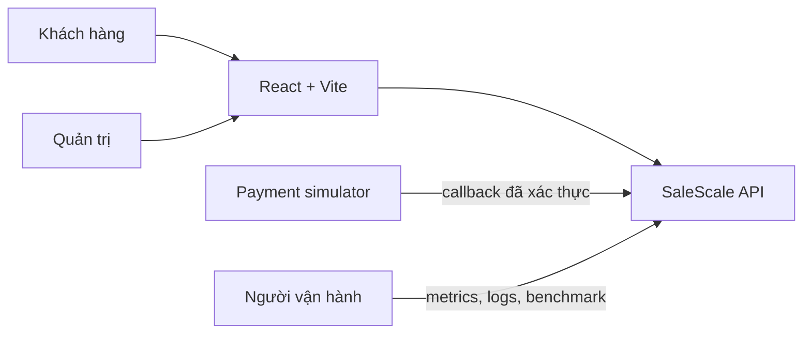
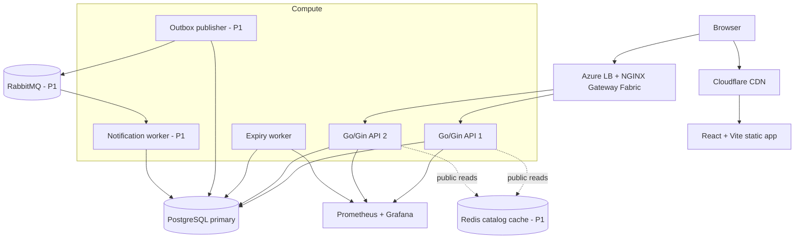
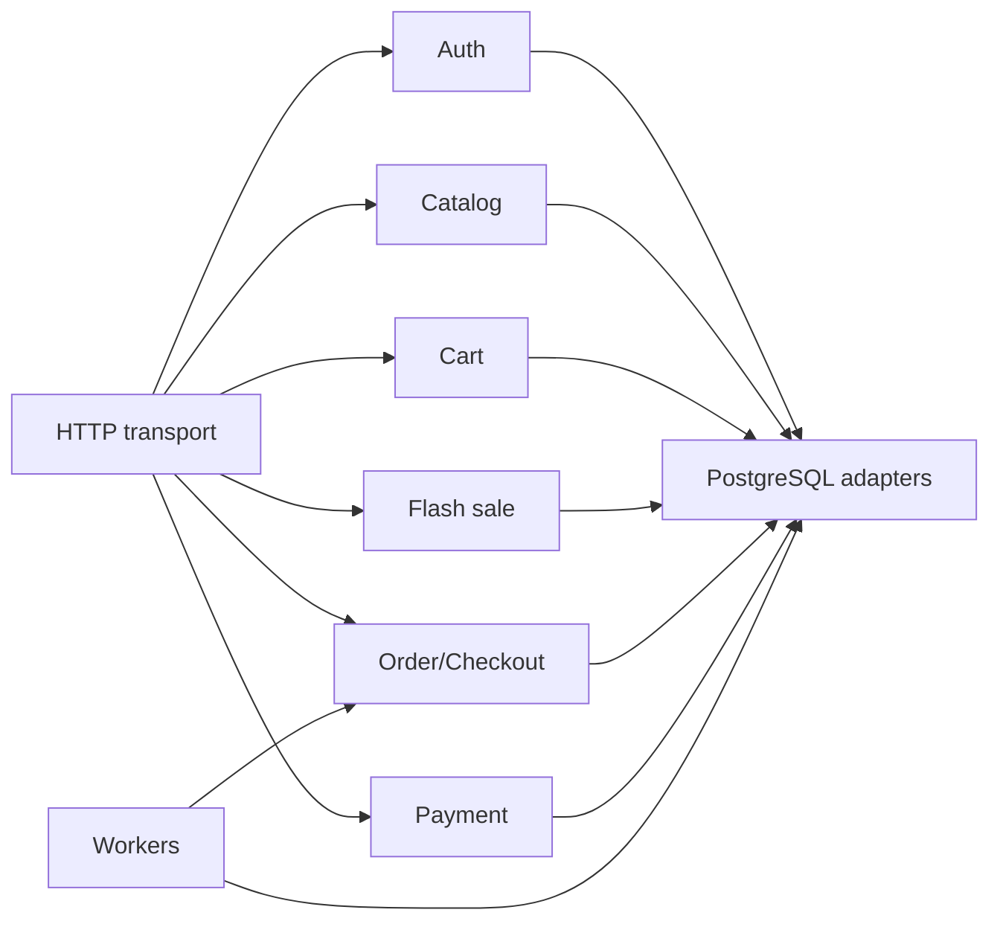
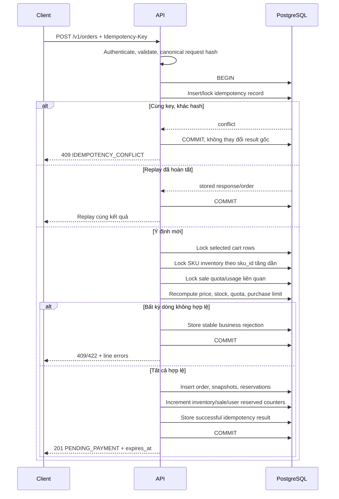
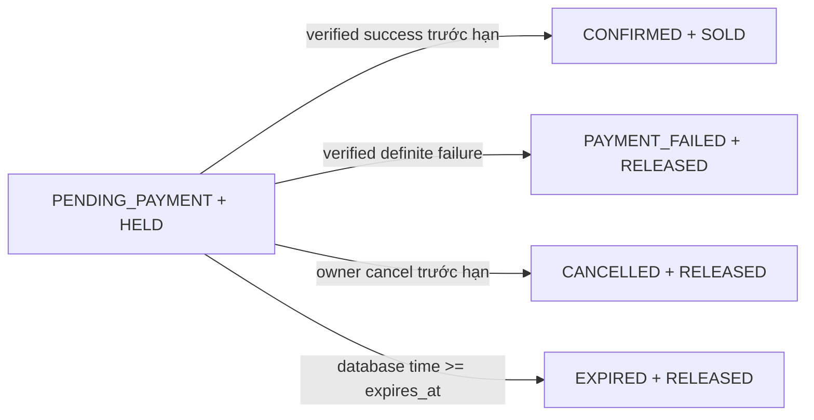

# Kiến trúc SaleScale

**Trạng thái:** Draft để duyệt trong phase SPECIFY
**Cập nhật:** 18/10/2026

## Mục đích và nguyên tắc

Kiến trúc phục vụ một cửa hàng trên mỗi bản triển khai và tập trung vào checkout nhiều SKU đúng dưới tải đồng thời. PostgreSQL quyết định mọi trạng thái liên quan tới danh tính, giá, tồn, quota, đơn, idempotency và thanh toán. Các thành phần khác có thể tăng tốc hoặc chuyển công việc ra khỏi request, nhưng không được thay quyền quyết định này.

Các nguyên tắc bắt buộc:

- API và worker có thể chạy nhiều instance mà không giữ trạng thái nghiệp vụ chỉ trong RAM.
- Checkout đồng bộ với PostgreSQL và hoàn tất transaction trước khi trả thành công.
- Payment simulator không nằm trong transaction checkout.
- Redis không quyết định giá/tồn/quota khi đặt đơn.
- RabbitMQ chỉ vận chuyển sự kiện notification; broker lỗi không làm mất order đã commit.
- Mọi đường cạnh tranh để kết thúc reservation phải dùng cùng state guard trong PostgreSQL.

## Context



Payment simulator là thành phần thử nghiệm do dự án kiểm soát. Nó tạo được sự kiện thành công, thất bại, chậm, lặp, sai thứ tự và mất phản hồi; không kết nối tiền thật hoặc provider sandbox.

## Container và nguồn dữ liệu



| Thành phần | Trách nhiệm | Không chịu trách nhiệm |
|---|---|---|
| React + Vite | UI demo khách/quản trị, giữ idempotency key cho một ý định checkout | Quyết định giá, tồn, role hoặc payment result |
| Go/Gin API | Auth, catalog, cart, checkout, order và payment callback | Giữ state có thẩm quyền chỉ trong process |
| PostgreSQL | Transaction và nguồn sự thật nghiệp vụ | Phân phối static asset |
| Expiry worker | Claim đơn đến hạn theo lô và kết thúc reservation đúng một lần | Gia hạn đơn hoặc sửa payment event |
| Redis P1 | Cache-aside cho catalog công khai | Cache dữ liệu riêng tư hoặc quyết định checkout |
| RabbitMQ P1 | Phân phối order-status event | Quyết định trạng thái order/inventory |
| Notification worker P1 | Ghi inbox idempotent rồi ACK | Cập nhật order/payment |
| NGINX | TLS/routing/load balancing/rate limit theo cấu hình | Chứng minh giới hạn toàn hệ thống nếu gateway được nhân bản |

## Cấu trúc backend

Backend là modular monolith. Module giao tiếp qua application service hoặc interface rõ ràng; không gọi trực tiếp bảng của module khác từ handler.



Checkout là orchestration boundary: nó đọc cart selection, khóa dữ liệu có thẩm quyền, kiểm tra sale/quota/purchase limit, tạo order snapshot và reservation, rồi ghi idempotency result trong một transaction.

## Luồng checkout P0



Không gọi payment simulator, Redis hoặc RabbitMQ khi transaction checkout đang mở. Business rejection có tính ổn định được lưu cùng idempotency record; lỗi hạ tầng làm rollback để client có thể retry cùng key.

## Luồng kết thúc reservation P0

Payment success, payment failure, customer cancellation và expiry worker cạnh tranh trên cùng order. Mỗi đường phải:

1. Khóa order và reservation liên quan.
2. Kiểm tra order còn `PENDING_PAYMENT` và điều kiện thời gian/quyền sở hữu phù hợp.
3. Chuyển trạng thái order bằng guard; bên mất cạnh tranh chỉ đọc trạng thái hiện tại.
4. Chuyển tất cả reservation `HELD` sang đúng một trạng thái kết thúc trong cùng transaction.
5. Cập nhật inventory, quota và purchase usage đúng với kết quả.



Callback đến muộn hoặc mâu thuẫn vẫn được lưu vào `payment_events`, nhưng không hồi sinh order hay thay đổi inventory. Nó được đánh dấu cần đối soát.

## Expiry worker

- Chọn batch hữu hạn các order `PENDING_PAYMENT` có `expires_at <= database time`.
- Dùng `FOR UPDATE SKIP LOCKED` hoặc cơ chế claim tương đương để nhiều worker không làm cùng một order.
- Xử lý mỗi order trong transaction ngắn; order đã bị payment/cancel kết thúc được bỏ qua an toàn.
- Không dựa vào timer in-memory. Worker restart phải tiếp tục tìm order đến hạn từ PostgreSQL.
- Metric tối thiểu: số order quét, số hết hạn thành công, số mất cạnh tranh, lỗi, backlog và độ trễ sau hạn.

## Boundary P1

### Outbox và notification

Khi order đổi sang trạng thái cần thông báo, transaction nghiệp vụ ghi thêm order event vào PostgreSQL outbox. Outbox publisher gửi event lên RabbitMQ và chỉ đánh dấu đã gửi sau publisher confirm. Notification worker ghi một notification duy nhất theo `event_id`, commit rồi mới ACK. Retry hữu hạn; message poison đi vào dead-letter queue.

Event contract tối thiểu:

```json
{
  "event_id": "uuid",
  "event_type": "order.confirmed",
  "order_id": "uuid",
  "user_id": "uuid",
  "occurred_at": "2026-10-18T00:00:00Z",
  "schema_version": 1
}
```

### Cache

Chỉ cache GET catalog/flash-sale công khai. Cache key phải chứa version và toàn bộ tham số lọc/phân trang. Admin mutation vô hiệu hóa key liên quan hoặc tăng namespace version. Cache miss fallback về PostgreSQL trong ngân sách hữu hạn; checkout luôn đọc PostgreSQL.

### Rate limit

Áp dụng riêng theo nhóm endpoint: login, public reads, checkout, payment callback và admin. Cấu hình phải công bố phạm vi limiter. Khi NGINX có nhiều replica, limiter cục bộ không được mô tả là quota toàn hệ thống.

## Môi trường

| Môi trường | Mục đích | Ràng buộc |
|---|---|---|
| Local developer | Viết code và chạy test nhanh | Có thể chạy một API; không dùng làm bằng chứng scaling |
| Docker Compose lab | Integration, fault test và baseline E0–E4 | Pin cấu hình/tài nguyên, seed/reset lặp lại được |
| AKS cloud target | Demo cùng container với nhiều API pod | Kết quả báo riêng; không tuyên bố HA/autoscaling nếu chưa triển khai và đo |

Cloud target dùng Azure Standard Load Balancer ở L4, NGINX Gateway Fabric ở L7, Azure Database for PostgreSQL làm primary. RabbitMQ một node trong demo không đại diện cho broker HA.

## Quan sát

Mỗi request có `request_id`; checkout có `idempotency_key` nhưng chỉ log dạng hash/rút gọn; order/payment event dùng ID để liên kết log, không dùng làm label metrics.

Metrics tối thiểu:

- HTTP count/latency theo route template, method và result class.
- Checkout new/replay/rejected/system-error; lý do từ chối hữu hạn.
- Transaction duration, lock wait, deadlock/retry và pool wait.
- Order transition count; expiry backlog/lag.
- Outbox age, RabbitMQ ready/unacked/retry/DLQ và notification delivery lag ở P1.

Không log mật khẩu, session token, cookie, callback secret, địa chỉ đầy đủ hoặc payment payload chưa lọc.

## Quyết định liên quan

- [ADR-003: Quyền tài liệu và thứ tự cập nhật](../decisions/003-document-authority.md)
- [ADR-004: PostgreSQL là nguồn trạng thái có thẩm quyền](../decisions/004-postgresql-authoritative-state.md)
- [ADR-005: Session phía server trong PostgreSQL](../decisions/005-postgresql-sessions.md)
- [ADR-006: AKS là cloud target](../decisions/006-aks-cloud-target.md)
