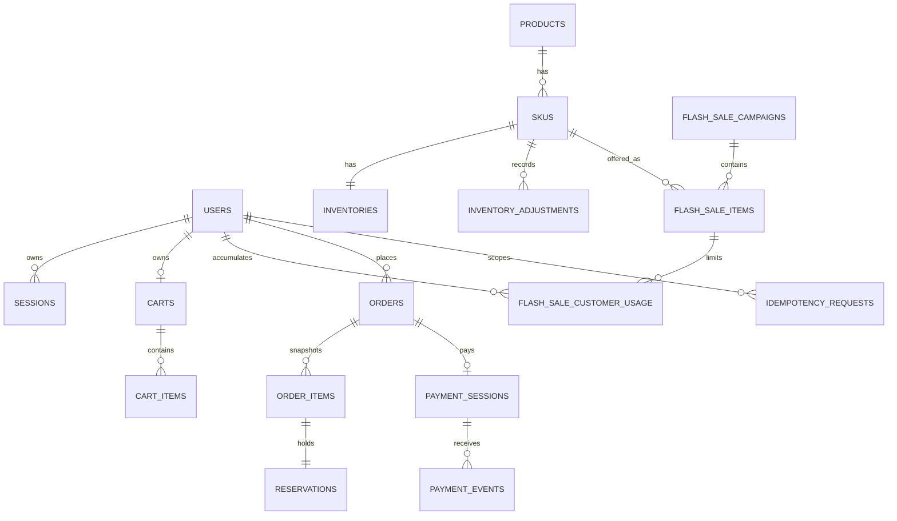

# Mô hình dữ liệu PostgreSQL P0

**Trạng thái:** Proposed — cần duyệt trước khi tạo migration
**Phạm vi:** Schema vật lý cho P0; P1 chỉ có contract logic ở cuối tài liệu

## Quy ước

- Primary key dùng UUID do application tạo; migration không phụ thuộc extension sinh UUID.
- Tất cả timestamp dùng `timestamptz` và lưu UTC.
- Tiền VND dùng `bigint`; `currency` cố định `VND` trong P0.
- Enum nghiệp vụ dùng `text` + `CHECK` để migration dễ thay đổi có kiểm soát.
- Email lưu cả giá trị hiển thị và `email_normalized = lower(trim(email))`; unique trên giá trị chuẩn hóa.
- Token/session secret không lưu dạng rõ; chỉ lưu hash có domain separation.
- `available`, quota còn lại và purchase limit còn lại là giá trị tính toán, không lưu thành counter độc lập.
- Mọi bảng mutable có `created_at`, `updated_at`; các bảng event/ledger chỉ append có `created_at` hoặc thời điểm chuyên biệt.

## Quan hệ chính



## Identity và session

### `users`

| Cột | Kiểu | Ràng buộc |
|---|---|---|
| `id` | `uuid` | PK |
| `email` | `text` | NOT NULL |
| `email_normalized` | `text` | NOT NULL, UNIQUE |
| `password_hash` | `text` | NOT NULL |
| `role` | `text` | `customer` hoặc `admin` |
| `status` | `text` | `active` hoặc `disabled` |
| `created_at`, `updated_at` | `timestamptz` | NOT NULL |

Constraint/index:

```sql
CHECK (email_normalized = lower(btrim(email_normalized)))
CHECK (role IN ('customer', 'admin'))
CHECK (status IN ('active', 'disabled'))
UNIQUE (email_normalized)
```

### `sessions`

| Cột | Kiểu | Ràng buộc |
|---|---|---|
| `id` | `uuid` | PK |
| `user_id` | `uuid` | FK `users`, NOT NULL |
| `token_hash` | `bytea` | NOT NULL, UNIQUE |
| `csrf_secret_hash` | `bytea` | NOT NULL |
| `expires_at` | `timestamptz` | NOT NULL |
| `revoked_at` | `timestamptz` | nullable |
| `last_seen_at`, `created_at` | `timestamptz` | NOT NULL |

Index phục vụ xóa session hết hạn: `sessions (expires_at) WHERE revoked_at IS NULL`. Session hợp lệ khi chưa revoke, chưa hết hạn và user vẫn active.

## Catalog và inventory

### `categories`

`id uuid PK`, `name text NOT NULL`, `slug text NOT NULL UNIQUE`, `is_visible boolean NOT NULL`, timestamps. P0 cần dữ liệu category để lọc catalog; UI quản trị category là P1.

### `products`

| Cột | Kiểu | Ràng buộc |
|---|---|---|
| `id` | `uuid` | PK |
| `category_id` | `uuid` | FK `categories`, nullable |
| `name`, `description` | `text` | name NOT NULL |
| `image_url` | `text` | nullable |
| `status` | `text` | `active`, `inactive` |
| `created_at`, `updated_at` | `timestamptz` | NOT NULL |

Index: `(category_id, status, id)` cho catalog phân trang; search theo tên được chọn index sau khi có query plan thật.

### `skus`

| Cột | Kiểu | Ràng buộc |
|---|---|---|
| `id` | `uuid` | PK |
| `product_id` | `uuid` | FK `products`, NOT NULL |
| `code` | `text` | NOT NULL, UNIQUE |
| `attributes` | `jsonb` | NOT NULL DEFAULT `{}` |
| `regular_price` | `bigint` | NOT NULL, `> 0` |
| `max_quantity_per_order` | `integer` | NOT NULL, `> 0` |
| `status` | `text` | `active`, `inactive` |
| timestamps | `timestamptz` | NOT NULL |

Không hard-delete product/SKU đã được order item tham chiếu.

### `inventories`

| Cột | Kiểu | Ràng buộc |
|---|---|---|
| `sku_id` | `uuid` | PK, FK `skus` |
| `on_hand` | `bigint` | NOT NULL, `>= 0` |
| `reserved` | `bigint` | NOT NULL, `>= 0`, `<= on_hand` |
| `version` | `bigint` | NOT NULL, `>= 0` |
| `updated_at` | `timestamptz` | NOT NULL |

```sql
CHECK (on_hand >= 0)
CHECK (reserved >= 0 AND reserved <= on_hand)
```

`available = on_hand - reserved`. Khi giữ hàng chỉ tăng `reserved`. Khi bán, cùng transaction giảm cả `on_hand` và `reserved`. Khi giải phóng chỉ giảm `reserved`.

### `inventory_adjustments`

`id uuid PK`, `sku_id uuid FK`, `actor_user_id uuid FK`, `delta bigint NOT NULL CHECK (delta <> 0)`, `on_hand_before bigint`, `on_hand_after bigint`, `reason text NOT NULL`, `created_at timestamptz`.

`on_hand_after = on_hand_before + delta` và phải giữ `on_hand_after >= inventory.reserved`. Service khóa hàng inventory, cập nhật counter và append ledger trong cùng transaction.

## Flash sale

### `flash_sale_campaigns`

| Cột | Kiểu | Ràng buộc |
|---|---|---|
| `id` | `uuid` | PK |
| `name` | `text` | NOT NULL |
| `status` | `text` | `draft`, `scheduled`, `stopped` |
| `starts_at`, `ends_at` | `timestamptz` | NOT NULL, `ends_at > starts_at` |
| timestamps | `timestamptz` | NOT NULL |

`active/ended` là trạng thái hiệu lực suy ra từ status và database time; không cần cron chỉ để đổi nhãn.

### `flash_sale_items`

| Cột | Kiểu | Ràng buộc |
|---|---|---|
| `id` | `uuid` | PK |
| `campaign_id` | `uuid` | FK, NOT NULL |
| `sku_id` | `uuid` | FK, NOT NULL |
| `sale_price` | `bigint` | NOT NULL, `> 0` |
| `quota_total` | `bigint` | NOT NULL, `> 0` |
| `quota_reserved` | `bigint` | NOT NULL DEFAULT 0 |
| `quota_sold` | `bigint` | NOT NULL DEFAULT 0 |
| `purchase_limit` | `integer` | NOT NULL, `> 0` |
| timestamps | `timestamptz` | NOT NULL |

```sql
UNIQUE (campaign_id, sku_id)
CHECK (quota_reserved >= 0 AND quota_sold >= 0)
CHECK (quota_reserved + quota_sold <= quota_total)
```

`sale_price < skus.regular_price` và việc một SKU không có hai campaign nhận đơn chồng thời gian là bất biến liên bảng, được kiểm tra trong transaction schedule. Transaction khóa các campaign/item liên quan theo `sku_id`; test đồng thời bắt buộc chứng minh không lọt overlap.

### `flash_sale_customer_usage`

| Cột | Kiểu | Ràng buộc |
|---|---|---|
| `flash_sale_item_id` | `uuid` | FK, PK part |
| `user_id` | `uuid` | FK, PK part |
| `reserved_quantity` | `bigint` | NOT NULL DEFAULT 0 |
| `sold_quantity` | `bigint` | NOT NULL DEFAULT 0 |
| `updated_at` | `timestamptz` | NOT NULL |

```sql
PRIMARY KEY (flash_sale_item_id, user_id)
CHECK (reserved_quantity >= 0 AND sold_quantity >= 0)
```

Service khóa row usage và kiểm tra `reserved_quantity + sold_quantity + requested <= purchase_limit` từ `flash_sale_items`.

## Cart

### `carts`

`id uuid PK`, `user_id uuid FK NOT NULL`, `status text CHECK (status IN ('active','archived'))`, timestamps.

```sql
CREATE UNIQUE INDEX carts_one_active_per_user
ON carts (user_id) WHERE status = 'active';
```

### `cart_items`

| Cột | Kiểu | Ràng buộc |
|---|---|---|
| `id` | `uuid` | PK |
| `cart_id` | `uuid` | FK, NOT NULL |
| `sku_id` | `uuid` | FK, NOT NULL |
| `quantity` | `integer` | NOT NULL, `> 0` |
| `intended_price_source` | `text` | `regular`, `flash_sale` |
| `flash_sale_item_id` | `uuid` | nullable FK |
| `version` | `bigint` | NOT NULL, bắt đầu 1 |
| timestamps | `timestamptz` | NOT NULL |

```sql
UNIQUE (cart_id, sku_id)
CHECK (quantity > 0)
CHECK (
  (intended_price_source = 'regular' AND flash_sale_item_id IS NULL) OR
  (intended_price_source = 'flash_sale' AND flash_sale_item_id IS NOT NULL)
)
```

## Order, reservation và idempotency

### `orders`

| Cột | Kiểu | Ràng buộc |
|---|---|---|
| `id` | `uuid` | PK |
| `order_number` | `text` | NOT NULL, UNIQUE, public identifier |
| `user_id` | `uuid` | FK, NOT NULL |
| `status` | `text` | trạng thái order hợp lệ |
| `currency` | `char(3)` | `VND` |
| `total_amount` | `bigint` | NOT NULL, `> 0` |
| `recipient_name` | `text` | NOT NULL |
| `recipient_phone` | `text` | NOT NULL |
| `recipient_address` | `text` | NOT NULL |
| `expires_at` | `timestamptz` | NOT NULL |
| `confirmed_at`, `terminal_at` | `timestamptz` | nullable |
| `version` | `bigint` | NOT NULL |
| `created_at`, `updated_at` | `timestamptz` | NOT NULL |

```sql
CHECK (status IN ('pending_payment','confirmed','payment_failed','cancelled','expired'))
CHECK (currency = 'VND')
CHECK (total_amount > 0)
CHECK (expires_at > created_at)
```

Indexes:

```sql
CREATE INDEX orders_by_owner ON orders (user_id, created_at DESC, id DESC);
CREATE INDEX orders_due
ON orders (expires_at, id) WHERE status = 'pending_payment';
```

### `order_items`

| Cột | Kiểu | Ràng buộc |
|---|---|---|
| `id` | `uuid` | PK |
| `order_id` | `uuid` | FK, NOT NULL |
| `line_number` | `smallint` | NOT NULL, `> 0` |
| `sku_id` | `uuid` | FK, NOT NULL |
| `sku_code_snapshot` | `text` | NOT NULL |
| `product_name_snapshot` | `text` | NOT NULL |
| `sku_attributes_snapshot` | `jsonb` | NOT NULL |
| `quantity` | `integer` | NOT NULL, `> 0` |
| `unit_price` | `bigint` | NOT NULL, `> 0` |
| `subtotal` | `bigint` | NOT NULL, `= quantity * unit_price` |
| `price_source` | `text` | `regular`, `flash_sale` |
| `flash_sale_item_id` | `uuid` | nullable FK |
| `cart_item_id` | `uuid` | nullable FK |
| `cart_item_version` | `bigint` | nullable |

```sql
UNIQUE (order_id, line_number)
UNIQUE (order_id, sku_id)
CHECK (quantity > 0 AND unit_price > 0)
CHECK (subtotal = quantity::bigint * unit_price)
CHECK (
  (price_source = 'regular' AND flash_sale_item_id IS NULL) OR
  (price_source = 'flash_sale' AND flash_sale_item_id IS NOT NULL)
)
```

`orders.total_amount = SUM(order_items.subtotal)` là bất biến liên bảng, được kiểm tra trước insert và trong test/verification query.

### `reservations`

| Cột | Kiểu | Ràng buộc |
|---|---|---|
| `id` | `uuid` | PK |
| `order_id` | `uuid` | FK, NOT NULL |
| `order_item_id` | `uuid` | FK, NOT NULL, UNIQUE |
| `sku_id` | `uuid` | FK, NOT NULL |
| `flash_sale_item_id` | `uuid` | nullable FK |
| `quantity` | `integer` | NOT NULL, `> 0` |
| `status` | `text` | `held`, `sold`, `released` |
| `expires_at` | `timestamptz` | NOT NULL |
| `finalized_at` | `timestamptz` | nullable |
| `created_at`, `updated_at` | `timestamptz` | NOT NULL |

```sql
UNIQUE (order_item_id)
CHECK (quantity > 0)
CHECK (status IN ('held','sold','released'))
CHECK (
  (status = 'held' AND finalized_at IS NULL) OR
  (status IN ('sold','released') AND finalized_at IS NOT NULL)
)
```

Index `(sku_id) WHERE status = 'held'` phục vụ đối chiếu INV-02. Mọi reservation của một order phải có cùng `expires_at` với order.

### `idempotency_requests`

| Cột | Kiểu | Ràng buộc |
|---|---|---|
| `id` | `uuid` | PK |
| `user_id` | `uuid` | FK, NOT NULL |
| `operation` | `text` | P0: `place_order` |
| `idempotency_key` | `text` | NOT NULL |
| `request_hash` | `char(64)` | SHA-256 hex của canonical payload |
| `state` | `text` | `processing`, `completed` |
| `order_id` | `uuid` | nullable FK |
| `response_status` | `integer` | nullable tới khi completed |
| `response_body` | `jsonb` | nullable tới khi completed |
| `created_at`, `completed_at` | `timestamptz` | NOT NULL/nullable |

```sql
UNIQUE (user_id, operation, idempotency_key)
CHECK (char_length(idempotency_key) BETWEEN 8 AND 255)
CHECK (state IN ('processing','completed'))
CHECK (
  state = 'processing' OR
  (completed_at IS NOT NULL AND response_status IS NOT NULL AND response_body IS NOT NULL)
)
```

Row `processing` được insert và chuyển `completed` trong cùng transaction checkout. Vì transaction chưa commit nên instance khác chỉ thấy row sau khi kết quả hoàn tất; crash/rollback không để lại khóa treo bền vững.

## Payment và đối soát

### `payment_sessions`

| Cột | Kiểu | Ràng buộc |
|---|---|---|
| `id` | `uuid` | PK |
| `order_id` | `uuid` | FK, NOT NULL, UNIQUE |
| `status` | `text` | `pending`, `unknown`, `succeeded`, `failed` |
| `amount` | `bigint` | NOT NULL, `> 0` |
| `currency` | `char(3)` | `VND` |
| `simulator_reference` | `text` | NOT NULL, UNIQUE |
| timestamps | `timestamptz` | NOT NULL |

Amount/currency phải bằng order snapshot tại lúc tạo session. Retry trả row hiện có do unique `order_id`.

### `payment_events`

| Cột | Kiểu | Ràng buộc |
|---|---|---|
| `id` | `uuid` | PK; event ID từ simulator |
| `payment_session_id` | `uuid` | FK, NOT NULL |
| `event_type` | `text` | `succeeded`, `failed` |
| `amount` | `bigint` | NOT NULL |
| `currency` | `char(3)` | NOT NULL |
| `payload_hash` | `char(64)` | NOT NULL |
| `source_verified` | `boolean` | NOT NULL |
| `result` | `text` | xử lý event |
| `reason_code` | `text` | nullable |
| `received_at`, `processed_at` | `timestamptz` | NOT NULL/nullable |

```sql
CHECK (event_type IN ('succeeded','failed'))
CHECK (result IN ('received','applied','duplicate','rejected','late','conflict'))
```

Insert theo event ID làm dedup. API chỉ xác nhận callback sau khi row được commit. Event sai nguồn/amount/currency được lưu với `rejected` và không đổi order.

### `payment_reconciliations`

`id uuid PK`, `payment_event_id uuid UNIQUE FK`, `order_id uuid FK`, `reason text`, `status text CHECK (status IN ('open','reviewed'))`, `reviewed_by uuid nullable FK`, `review_note text nullable`, `created_at`, `reviewed_at`.

P0 bắt buộc tạo case cho success đến muộn hoặc event mâu thuẫn; UI quản trị/ghi chú hoàn chỉnh là P1.

## Thứ tự khóa và transaction boundary

### Checkout

1. Idempotency row theo `(user, operation, key)`.
2. Cart item theo ID tăng dần.
3. Inventory theo `sku_id` tăng dần.
4. Flash sale item theo `id` tăng dần.
5. Customer usage theo `(flash_sale_item_id, user_id)` tăng dần.
6. Insert order/items/reservations và cập nhật counter.

Mọi code path khác cần khóa nhiều inventory/sale row phải dùng cùng thứ tự.

### Kết thúc order

1. Order row.
2. Reservation/order item theo `sku_id` tăng dần.
3. Inventory theo `sku_id` tăng dần.
4. Flash sale item và usage theo ID tăng dần.
5. Payment event/session nếu transition bắt nguồn từ payment.

Không giữ transaction trong lúc gọi HTTP, RabbitMQ hoặc Redis.

## Query kiểm chứng bất biến

Các query này là oracle sau integration/load test, không phải endpoint public.

```sql
-- INV-02: counter inventory khớp tổng reservation HELD.
SELECT i.sku_id, i.reserved, COALESCE(SUM(r.quantity), 0) AS held
FROM inventories i
LEFT JOIN reservations r ON r.sku_id = i.sku_id AND r.status = 'held'
GROUP BY i.sku_id, i.reserved
HAVING i.reserved <> COALESCE(SUM(r.quantity), 0);

-- INV-03: order pending thiếu reservation cho bất kỳ dòng nào.
SELECT o.id
FROM orders o
JOIN order_items oi ON oi.order_id = o.id
LEFT JOIN reservations r ON r.order_item_id = oi.id AND r.status = 'held'
WHERE o.status = 'pending_payment'
GROUP BY o.id
HAVING COUNT(*) <> COUNT(r.id);

-- INV-11: tổng order khác tổng snapshot dòng.
SELECT o.id
FROM orders o
JOIN order_items oi ON oi.order_id = o.id
GROUP BY o.id, o.total_amount
HAVING o.total_amount <> SUM(oi.subtotal);
```

`testing.md` phải bổ sung oracle cho quota, customer usage, terminal reservation và inventory ledger trước khi chạy benchmark.

## Boundary dữ liệu P1

Chưa tạo migration trong phase này, nhưng contract logic được giữ:

- `outbox_events(event_id PK, aggregate_type, aggregate_id, event_type, payload, occurred_at, published_at, attempts, next_attempt_at)`.
- `notifications(id PK, event_id UNIQUE, user_id, order_id, type, body, read_at, created_at)`.
- Event outbox được insert cùng transaction đổi order; publisher confirm trước khi set `published_at`.
- Redis key không được chứa session/cart/order/payment; cache invalidation không nằm trong transaction checkout.

## Migration và dữ liệu

- Migration chỉ tiến về trước trong môi trường chia sẻ; rollback phá dữ liệu phải có script/backup riêng.
- Constraint và index được tạo cùng migration sở hữu bảng; index lớn trong dữ liệu benchmark cần ghi thời gian/locking.
- Seed demo và seed benchmark tách nhau; reset benchmark chỉ tác động database thử nghiệm có guard rõ ràng.
- Không dùng migration để âm thầm đổi `BR/INV`; cập nhật PRD và ADR trước.

