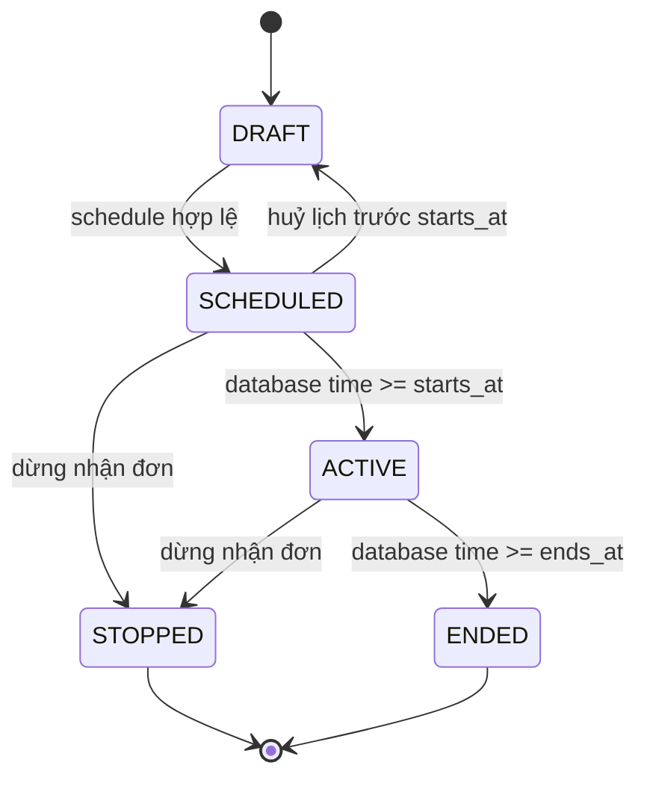
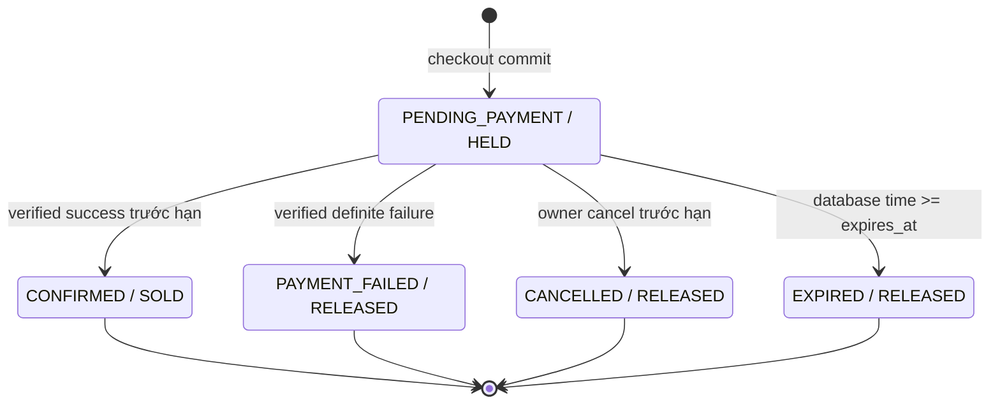
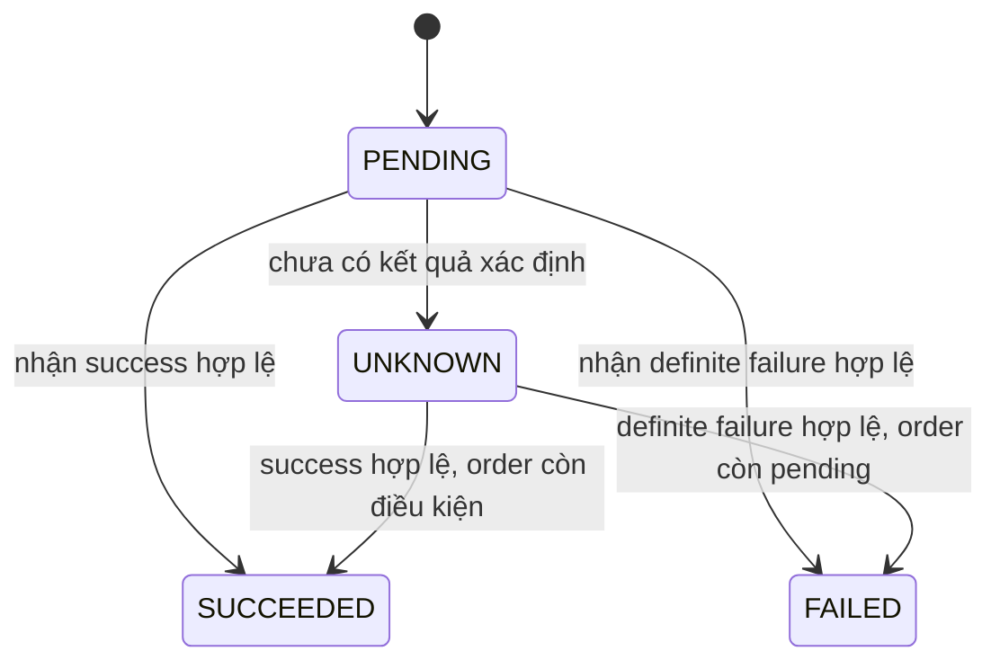

# Mô hình miền SaleScale

**Trạng thái:** Draft để duyệt trong phase SPECIFY
**Nguồn nghiệp vụ:** [PRD](../product/prd.md), đặc biệt mục 5–7 và `INV-01` đến `INV-12`

## Ngôn ngữ chung

| Thuật ngữ | Nghĩa trong SaleScale |
|---|---|
| Product | Mặt hàng khách nhìn thấy; có một hoặc nhiều SKU |
| SKU | Biến thể bán và quản lý tồn độc lập |
| `on_hand` | Số đơn vị vật lý hiện còn; chỉ giảm khi reservation chuyển thành bán |
| `reserved` | Số đơn vị đang giữ cho các order chờ thanh toán |
| `available` | `on_hand - reserved`, là giá trị tính toán |
| Cart | Danh sách ý định mua; không giữ tồn hoặc quota |
| Preview | Báo giá tại một thời điểm; không phải reservation |
| Order | Bản chụp các dòng đã chốt giá và người nhận |
| Reservation | Quyền giữ một số lượng SKU cho một order item tới hạn cụ thể |
| Idempotency key | Định danh một ý định checkout của một user |
| Payment session | Phiên mô phỏng thanh toán duy nhất của một order |
| Payment event | Sự kiện bất đồng bộ, có định danh, được lưu trước khi ACK |
| Reconciliation | Bản ghi cần con người rà soát khi payment event không thể áp dụng an toàn |

## Ranh giới aggregate

### Identity

- `User` sở hữu email chuẩn hóa, password hash và role.
- `Session` là opaque server-side session, có hạn và có thể revoke.
- Role chỉ do server gán; endpoint đăng ký luôn tạo customer.

### Catalog và Inventory

- `Product` chứa dữ liệu hiển thị; `SKU` là đơn vị giá và tồn.
- `Inventory` có đúng một bản ghi cho mỗi SKU.
- `InventoryAdjustment` là ledger audit; không sửa trực tiếp counter mà không ghi lý do/tác nhân.
- Không xóa SKU đã được order/reservation tham chiếu; chỉ chuyển inactive.

### FlashSale

- `FlashSaleCampaign` quản lý thời gian và lifecycle.
- `FlashSaleItem` gắn một SKU với sale price, quota và purchase limit.
- `CustomerSaleUsage` giữ counter đang reservation/đã mua theo user + flash-sale item.
- Kết thúc campaign chỉ ngăn order mới; reservation hợp lệ đã có vẫn sống tới hạn order.

### Cart

- Mỗi user có tối đa một cart active.
- Một SKU chỉ xuất hiện một lần trong cart; quantity được gộp.
- `CartItem.version` tăng khi quantity hoặc nguồn giá mong đợi đổi, giúp xóa an toàn sau payment success.
- Cart không sở hữu inventory và không tạo reservation.

### Order

- `Order` là aggregate root của order items và reservations.
- Order được tạo khi và chỉ khi tất cả dòng đều hợp lệ và reservation đầy đủ được commit.
- `OrderItem` lưu snapshot SKU, đơn giá, price source và subtotal; thay đổi catalog sau đó không sửa snapshot.
- Mỗi order item có đúng một reservation P0.
- Một order có một `expires_at` cố định bằng thời điểm tạo + 5 phút; retry không đổi hạn.

### Payment

- Một order có tối đa một payment session; gọi lại trả session cũ.
- Payment event được deduplicate theo event ID và được lưu dù hợp lệ, lặp, muộn hay mâu thuẫn.
- Event chỉ tác động order khi nguồn/phiên/số tiền/tiền tệ hợp lệ và state guard thắng.
- Reconciliation không tự hoàn tiền, hồi sinh order hoặc sửa inventory.

## Trạng thái FlashSale

`ACTIVE` có thể được suy ra từ thời gian thay vì cập nhật đồng hồ theo lịch, nhưng API phải trả trạng thái hiệu lực nhất quán. `SCHEDULED`, `ACTIVE`, `STOPPED`, `ENDED` không cho sửa sale price/quota/purchase limit trực tiếp.

## Trạng thái Order và Reservation

| Chuyển trạng thái | Guard bắt buộc | Tác động nguyên tử |
|---|---|---|
| Tạo `PENDING_PAYMENT` | Tất cả dòng, giá, sale, inventory, quota và limit hợp lệ | Tạo order/items/reservations; tăng `inventory.reserved`, `quota_reserved`, `usage.reserved` |
| `PENDING_PAYMENT → CONFIRMED` | Event hợp lệ; database time `< expires_at`; order còn pending | Reservation `HELD → SOLD`; giảm `on_hand` và `reserved`; quota/usage reserved → sold |
| `PENDING_PAYMENT → PAYMENT_FAILED` | Thất bại chắc chắn đã xác minh; order còn pending | Reservation `HELD → RELEASED`; giảm các counter reserved |
| `PENDING_PAYMENT → CANCELLED` | Chủ order; database time `< expires_at`; order còn pending | Reservation `HELD → RELEASED`; giảm các counter reserved |
| `PENDING_PAYMENT → EXPIRED` | Database time `>= expires_at`; order còn pending | Reservation `HELD → RELEASED`; giảm các counter reserved |

Thao tác lặp hoặc bên thua cạnh tranh không chạy lại tác động counter. Nó trả trạng thái hiện tại hoặc kết quả event đã lưu.

## Trạng thái PaymentSession

Payment session và order không bị ép có trạng thái giống nhau. Ví dụ session/event có thể ghi nhận `SUCCEEDED` nhưng order đã `EXPIRED`; trường hợp đó tạo reconciliation và không thay inventory.

## Idempotency

Identity của một checkout là `(user_id, operation, idempotency_key)`.

Request hash được tạo từ biểu diễn canonical của:

- tập cart item và version đã chọn, sắp xếp ổn định;
- SKU, quantity, price source, sale item và unit price đã xác nhận;
- expected total/currency;
- tên, số điện thoại và địa chỉ người nhận sau chuẩn hóa.

| Trường hợp | Kết quả |
|---|---|
| Key mới | Xử lý một lần và lưu response ổn định |
| Cùng key, cùng hash, đã hoàn tất | Replay status/body/order cũ; không gia hạn |
| Cùng key, khác hash | `409 IDEMPOTENCY_CONFLICT` |
| Request trước đang xử lý | Chờ lock hữu hạn hoặc trả `409 IDEMPOTENCY_IN_PROGRESS`; client retry cùng key |
| Lỗi hạ tầng làm rollback | Không lưu kết quả giả; retry cùng key được xử lý lại |

Business rejection xác định như giá đổi, thiếu hàng, hết quota hoặc vượt limit được lưu làm idempotent result. `5xx`/timeout nội bộ không được lưu như kết quả nghiệp vụ thành công.

## Bất biến và chủ sở hữu

| Bất biến | Aggregate/counter bảo vệ | Cơ chế chính |
|---|---|---|
| INV-01, INV-02, INV-12 | Inventory + Reservation | Row lock, check constraint, ledger adjustment |
| INV-03, INV-04 | Order | Một transaction checkout; rollback toàn bộ |
| INV-05 | Idempotency | Unique key + request hash + stored response |
| INV-06, INV-08 | Order + Reservation | State guard và transition transaction |
| INV-07 | Payment + Order | Unique event + verified payload + guarded confirm |
| INV-09 | FlashSaleItem | Quota counters + check constraint |
| INV-10 | CustomerSaleUsage | Unique user/item row + row lock + check constraint |
| INV-11 | Order snapshot + PaymentSession | Integer money, stored subtotal/total và equality check trong service |

Database constraint chặn trạng thái không thể hợp lệ trên một row; transaction/application service chặn bất biến liên bảng. Test phải kiểm tra cả hai lớp.

## Lỗi nghiệp vụ ổn định

| Mã | Khi dùng | HTTP đề xuất |
|---|---|---|
| `VALIDATION_ERROR` | Payload sai cấu trúc/giới hạn | 422 |
| `UNAUTHENTICATED` | Không có session hợp lệ | 401 |
| `FORBIDDEN` | Sai role hoặc không sở hữu resource | 403 |
| `RESOURCE_NOT_FOUND` | Resource không tồn tại/không được phép tiết lộ | 404 |
| `PRICE_CHANGED` | Giá/nguồn giá/tổng khác xác nhận | 409 |
| `ITEM_UNAVAILABLE` | Product/SKU không active | 409 |
| `INSUFFICIENT_STOCK` | `available < requested` | 409 |
| `SALE_NOT_ACTIVE` | Sale chưa mở/đã dừng/kết thúc | 409 |
| `SALE_QUOTA_EXCEEDED` | Quota còn lại không đủ | 409 |
| `PURCHASE_LIMIT_EXCEEDED` | Reserved + sold + requested vượt limit | 409 |
| `IDEMPOTENCY_CONFLICT` | Cùng key, khác request hash | 409 |
| `ORDER_NOT_PAYABLE` | Order không còn pending/trước hạn | 409 |
| `STATE_TRANSITION_CONFLICT` | Mất cạnh tranh chuyển trạng thái | 409 |
| `RATE_LIMITED` | Bị giới hạn tải | 429 |
| `INTERNAL_ERROR` | Lỗi không công bố chi tiết | 500 |

Error message có thể dịch/chỉnh câu chữ; client phải dựa vào `code` và `details` có schema ổn định.

## Boundary P1 trong domain

- `OrderStatusEvent` được tạo cùng transaction với order transition; event không thay thế transition.
- `Notification` thuộc user, unique theo `event_id`, có `read_at` tùy chọn.
- Cache entry không phải domain entity và không xuất hiện trong aggregate checkout.
- Rate limit rejection không tạo order, reservation, idempotency business result hoặc payment event.

